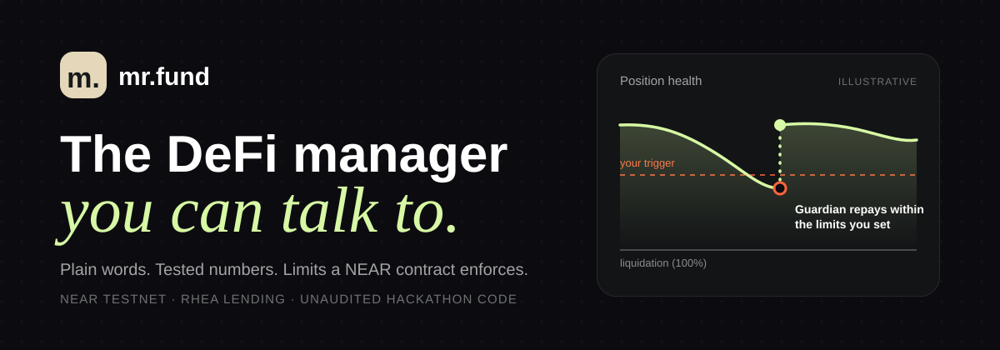
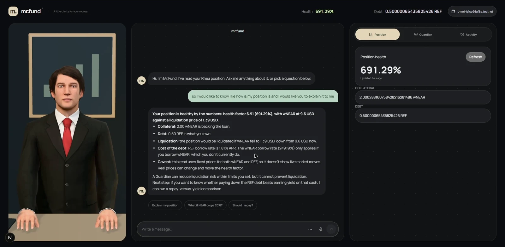
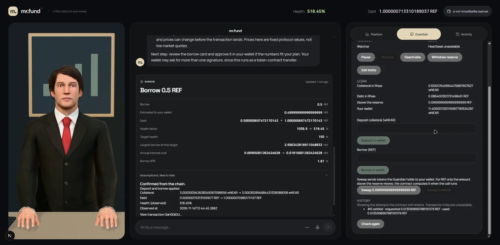
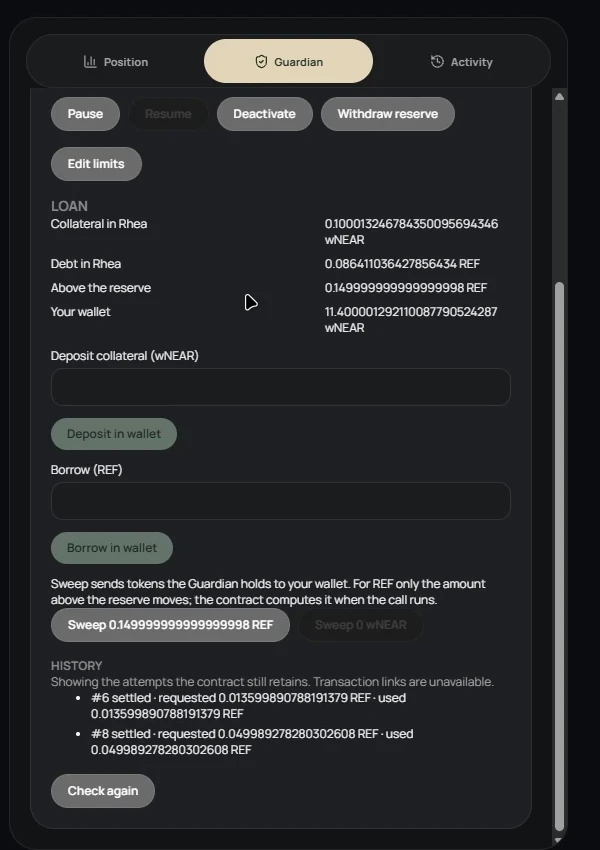
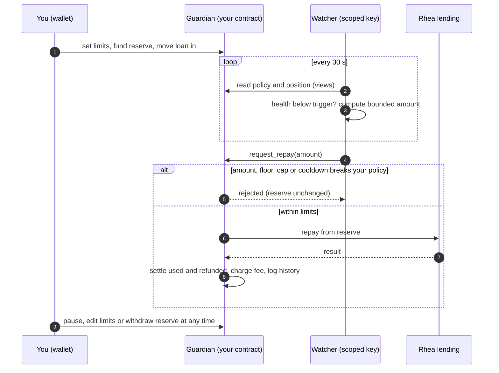

<div align="center">



<br>

### Talk to your loan. Let a contract keep it inside the limits you set.

Mr.Fund is a character you talk to about your Rhea lending position on NEAR. He explains it in plain words, shows the smartest move, and never produces a number himself.<br>
A per-user **Guardian** contract can repay part of your debt when health falls below your trigger. It acts only inside limits you wrote, and the contract, not the AI, decides.

[**Evidence**](#proof-not-promises) · [**Why NEAR**](#why-near) · [**How it works**](#how-it-works) · [**Try it**](#try-it) · [**PRD**](docs/PRD.md) · [**Guardian spec**](docs/technical/SMART-CONTRACT.md)

    

Built for the NEAR hackathon · **Unstoppable DeFi** · **AI Security & Defense**

</div>

> [!WARNING]
> **Testnet only. Not audited.** Everything marked as observed ran on NEAR testnet against Rhea's testnet lending contract with **fixed** test prices, not market prices. Mr.Fund reduces liquidation risk within limits you set. It does not prevent liquidation.

## In 30 seconds

| | |
| --- | --- |
| **What it is** | A conversational manager for a Rhea lending position. You ask in your own language; he reads the real position and answers with numbers from a tested finance engine. |
| **What is different** | The model can talk but cannot sign, and cannot invent a number: a reply that contains a figure no tool returned is rejected. Automatic repays go through a contract that enforces your limits on-chain. |
| **What exists today** | Live chat on a real testnet position, wallet-signed deposit and borrow from chat cards, a Guardian factory and Guardian contracts on testnet, and a watcher process that has sent **two** accepted repays and had an over-limit request **refused on-chain**. |
| **What does not exist yet** | A hosted, always-running watcher, mainnet, an audit, and an accepted chat model. See [Guarantees and limits](#guarantees-and-limits). |
| **Try it** | [Run the demo locally](#try-it) (labelled **Simulated** without a wallet), or [check the chain yourself](#verify-it-yourself) in a minute. |

## The problem

Borrowing on a lending protocol is easy to start and hard to understand while the loan is open. The screen shows a health factor, two APYs and a liquidation price, and the borrower works out alone:

- Is my loan getting more dangerous, and how close is liquidation?
- Is it smarter to repay now or to put spare money to work?
- What happens to me if the collateral price drops 20%?

The cost of not knowing is real. On Rhea, liquidation begins below a health factor of 100%, and the liquidator's discount grows as health falls: `(1 − health) / 2`, for example 6.25% at 87.5% health ([Rhea liquidation guide, read 2026-11-02](docs/PRD.md)).

What borrowers have today is a dashboard with numbers and no judgment, a spreadsheet, a protection bot behind a configuration screen they rarely read, or a general chatbot that will happily invent a rate.

## The solution: a manager who talks, code that counts, a contract that decides

Three rules that never bend:

1. **The AI talks.** The language model explains and proposes. It has no tool that signs or sends a transaction.
2. **Deterministic code decides numbers.** Every rate, health factor, amount and fee on screen comes from `packages/engine` with its inputs, assumptions and data age. A reply that contains a number no tool returned is rejected before the user sees it.
3. **The contract decides permissions.** Automatic actions go only through the Guardian's `request_repay`, which enforces your policy on-chain. Manual actions are signed in your own wallet. Nobody ever asks for or handles your private key.

| If something goes wrong... | A typical setup | With Mr.Fund |
| --- | --- | --- |
| The model hallucinates a rate or an amount | You may act on it | The number guard rejects any figure a tool did not return. The reply falls back to a plain refusal. |
| The watcher asks for more than you allowed | Depends on the bot's own code | The Guardian contract refuses. Observed on testnet: `rejected` / `above_max_per_action`, reserve and spent total unchanged. |
| Someone else calls the Guardian | Depends | `Owner or watcher only`. Observed on testnet with a non-owner account. |
| The watcher's key leaks | Often full account access | The key can only call `request_repay` on one Guardian, with a 1 NEAR gas allowance, and cannot attach a deposit, so it cannot call any owner method. |
| You want out | Find the right screen | Pause, deactivate or withdraw the reserve from the panel. The owner can always withdraw the reserve that is not locked in a running action. |

## What it looks like

All three images are frames from the owner's recording on NEAR testnet (account `d-mrf-b1ce96af6a.testnet`).

<p align="center"></p>

*He reads the real Rhea position and explains it in plain words. The caveat about fixed testnet prices comes from the data, not from the model's mood.*

<p align="center"></p>

*A recommendation card with the numbers, assumptions and fees before you sign, then "Confirmed from the chain" only after the outcome was read back.*

<p align="center"></p>

*The Guardian panel: your limits, the loan it holds, and a history of what the contract did. Operations 6 and 8 are the two watcher repays described under [Proof](#proof-not-promises).*

## Why NEAR

The Guardian needs a **separate contract account per user**, **keys that can do one thing only**, and **a callback chain that cannot be skipped**. NEAR gives each of these as a protocol feature, not as a workaround.

| NEAR capability | Role in Mr.Fund | Proof |
| --- | --- | --- |
| **Contract accounts created from a factory** | `create_guardian` derives `<32 hex of sha256(owner ‖ nonce)>.<factory>` and, in one batch, creates the account, funds it, deploys the Guardian and initialises it. Each user's loan and reserve live in their own account. | Guardian `32a8f0b7…2.testnet` below |
| **Accounts with zero access keys** | The Guardian is created with **no access key and no upgrade path** (invariant I10). Nobody can sign as it, including us. | `view_access_key_list` returns `[]` ([check](#verify-it-yourself)) |
| **Function-call access keys** | The watcher signs with a key limited to `request_repay` on one Guardian, with a 1 NEAR allowance. Function-call keys cannot attach a deposit, and every owner method requires exactly 1 yoctoNEAR, so the watcher cannot reach owner methods at all. | [Over-limit refusal](https://testnet.nearblocks.io/txns/2m5cxjPh458pAgQ8pMAubnRisFC2fDJTLSy8oX525Mqr) |
| **Promises and callbacks** | A repay is a chain of cross-contract calls (token transfer, Rhea `execute`, settlement callbacks). The Guardian checks every promise result and books `used` and `refunded` amounts, so a first receipt's success is never taken as the outcome. | 32 receipts, none failed, in each accepted repay |
| **Human-readable accounts** | Users see and own `name.testnet` accounts, and every Guardian id is derivable and queryable from its owner. | `get_guardian(owner_id)` on the factory |
| **NEAR AI Cloud** | The chat model is served through NEAR AI Cloud. The model id is configuration, not code. | [CHAT-API](docs/technical/CHAT-API.md) |
| **NEAR Connect and Meteor** | Sign-in and every manual transaction are signed in the user's own wallet. | Owner-signed flows below |

The design does not work on a chain where the contract account that holds the loan must be a key someone controls, or where one key cannot be scoped to a single method on a single contract.

## Ecosystem integration

| Technology | How Mr.Fund uses it |
| --- | --- |
| **NEAR Protocol** | Rust contracts built on `near-sdk`: a Guardian factory and the Guardian. Accounts, access keys, promises and storage staking as described in [Why NEAR](#why-near). Sandbox tests use `near-workspaces`. |
| **Rhea Finance lending** | The real lending protocol the Guardian holds a loan on. Collateral is wNEAR and debt is the REF test token on `contract.1689937928.burrow.testnet` (version 0.11.0). Contract tests also run against the deployed mainnet bytecode (0.16.2) with **Simulated** prices. |
| **NEAR AI Cloud** | LLM provider for the chat, with tool calling. Which model and which privacy tier is **not final** (decision D25 is open; see [Privacy](#privacy-and-key-custody)). |
| **NEAR Connect and Meteor Wallet** | Login and wallet signing. NEAR Auth (email) is also wired as a second login path. |
| **Not used** | NEAR Intents, Chain Signatures and a live price oracle. Testnet prices are Rhea's fixed `default_price` values. There is no cross-chain claim. |

## How it works

**Meeting the position.** You connect a wallet. Mr.Fund reads your public Rhea position, the engine computes health, liquidation price and what-ifs, and the model turns the engine's output into plain words in your language. Action cards (deposit, borrow, repay) carry the numbers, assumptions and fees. You sign in your wallet; the receipt appears only after the chain was read back.

**Guarding it.** You create a Guardian, choose limits, fund a reserve and (in the Loan section) move the loan into the Guardian, because Rhea only lets an account repay its own debt. From then on a watcher process can request a repay, and the contract decides.



| Piece | Role | Can it move your money? |
| --- | --- | --- |
| **Web app** (`apps/web`) | Chat, cards and the Guardian panel | Only by asking your wallet to sign. |
| **Engine** (`packages/engine`, `packages/rhea`) | Health, liquidation price, what-ifs, fees as exact integers | No. Read-only math. |
| **Agent** (`packages/agent`) | Tool-calling chat with the number guard | No. It imports no signer. |
| **Guardian** (`contracts/guardian`) | Holds the loan and reserve, enforces limits I1 to I10 | Only inside your policy. |
| **Factory** (`contracts/guardian-factory`) | Creates one keyless Guardian per user | It cannot touch a Guardian after creation. |
| **Watcher** (`apps/watcher`) | Polls, decides, requests. No language model. | It can only ask; the contract answers. |

### The limits you set

| Limit | Meaning |
| --- | --- |
| Max per action | The most one automatic repay may use. |
| Max total (optional) | Lifetime cap on what automatic repays may spend. |
| Reserve floor | The reserve never drops below this because of an automatic action. |
| Act below health | The trigger. The contract itself re-checks it with fresh prices (minimum 105%). |
| Aim for health (optional) | A target to repay toward. |
| Cooldown | Minimum gap between actions (minimum 5 minutes). |
| Action fee | Charged only when a repay is used. Shown before you activate. |

You can edit these later from the panel with one wallet signature; the panel then re-reads the chain and says whether the contract holds the new values.

## Proof, not promises

> [!IMPORTANT]
> **A watcher process sent two accepted repays, and a request above the limit was refused on-chain.** All observed on NEAR testnet; open any link to check.

| Claim | Evidence | Observed |
| --- | --- | --- |
| **The watcher repaid on its own, twice** | Signer `w-mrf-b1ce96af6a.testnet`, method `request_repay`, deposit 0. First: [`8YXX7F6B…`](https://testnet.nearblocks.io/txns/8YXX7F6BTAKenTLXM3Wtdi4xVYGCopyW27LycTuZ2TPt) (op 6, 0.0136 REF plus a 0.004 REF fee). Second, from a fresh process: [`D9BprUfo…`](https://testnet.nearblocks.io/txns/D9BprUfogm64pFQNZy6ffEHhUyDeHPC4wBJLJngdZZ9A) (op 8, 0.04999 REF plus the fee). Each is FINAL with 32 receipts, none failed. | 2026-11-14 |
| **The contract refuses what you did not allow** | The watcher's scoped key asked for one atomic unit above the per-action limit: [`2m5cxjPh…`](https://testnet.nearblocks.io/txns/2m5cxjPh458pAgQ8pMAubnRisFC2fDJTLSy8oX525Mqr), recorded as `rejected` / `above_max_per_action`; reserve and spent total identical before and after. | 2026-11-13 |
| **Strangers are refused** | A non-owner `request_repay`: [`CSMiVJvH…`](https://testnet.nearblocks.io/txns/CSMiVJvHWi1QfdCuHTS26rtRdh2mFUfy4m65U5Dg9ifr), `Smart contract panicked: Owner or watcher only`. | 2026-11-13 |
| **Owner-requested repay** | [`Hb5nC4Sb…`](https://testnet.nearblocks.io/txns/Hb5nC4SboDszVExBibSSJ24eFAazecrf9v8N6PqGmzA): 0.05 REF repaid after the contract's own trigger check (debt 0.08 to 0.03 REF, health 216% to 576%). | 2026-11-13 |
| **The Guardian has no keys** | `view_access_key_list` on the Guardian returns an empty list. | Re-checkable now |
| **Manual repay signed in a wallet** | A 0.01 REF repay from a live chat card; the receipt read back from the chain matched an independent read. The transaction hash was not recorded in this repository. | 2026-11-13 |
| **Code evidence** | Workspace tests: 2015 passed, 22 skipped (152 files), typecheck clean, lint clean, production build ok. Negative tests for every money-path verifier are listed in [INTEGRATIONS](docs/technical/INTEGRATIONS.md). | 2026-11-14 |

Details, amounts and caveats for each row: [SMART-CONTRACT](docs/technical/SMART-CONTRACT.md).

### Verify it yourself

These read-only commands ran on 2026-11-14 against the live demo Guardian. They need `curl`, `base64` and Node 22 (already required by this repo).

```sh
G=32a8f0b796d281ff12044eb67d6e22bc.f2-mrf-b1ce96af6a.testnet
RPC=https://test.rpc.fastnear.com
view() { curl -s "$RPC" -H 'content-type: application/json' -d '{"jsonrpc":"2.0","id":1,"method":"query","params":{"request_type":"call_function","finality":"final","account_id":"'$G'","method_name":"'$1'","args_base64":"'$(printf '%s' "$2" | base64 -w0)'"}}' | node -e 'let s="";process.stdin.on("data",d=>s+=d).on("end",()=>console.log(Buffer.from(JSON.parse(s).result.result).toString()))'; }

# 1. Nobody holds a key to the Guardian
curl -s "$RPC" -H 'content-type: application/json' -d '{"jsonrpc":"2.0","id":1,"method":"query","params":{"request_type":"view_access_key_list","finality":"final","account_id":"'$G'"}}' | node -e 'let s="";process.stdin.on("data",d=>s+=d).on("end",()=>console.log(JSON.stringify(JSON.parse(s).result.keys)))'

# 2. The limits the contract enforces
view get_policy '{}'

# 3. What the contract did
view get_history '{"from":0,"limit":50}'
```

```text
[]
{"max_per_action":"50000000000000000","lifetime_cap":"100000000000000000","reserve_floor":"20000000000000000","trigger_hf_bps":20000,"target_hf_bps":null,"cooldown_sec":300,"action_fee":"4000000000000000"}
[{"op_id":"6",…"requested":"13599890788191379","outcome":"settled",…"used":"13599890788191379","fee":"4000000000000000"},{"op_id":"8",…"requested":"49989278280302608","outcome":"settled",…"used":"49989278280302608","fee":"4000000000000000"}]
```

Amounts are integers in the token's smallest unit (REF has 18 decimals), so `50000000000000000` is 0.05 REF. The history is the contract's own bounded log of recent attempts; it carries no transaction hashes, which is why the links above come from the explorer.

### Deployed on testnet

| | Account |
| --- | --- |
| Factory | `f2-mrf-b1ce96af6a.testnet` |
| Demo Guardian | `32a8f0b796d281ff12044eb67d6e22bc.f2-mrf-b1ce96af6a.testnet` (owner `d-mrf-b1ce96af6a.testnet`) |
| Earlier Guardian | `db96d75ceb76d9bc8693963a3a0a53d8.f2-mrf-b1ce96af6a.testnet` (first loan and owner-requested repay) |
| Watcher account | `w-mrf-b1ce96af6a.testnet` |
| Fee recipient | `fee-mrf-b1ce96af6a.testnet` |
| Lending, debt token, collateral token | `contract.1689937928.burrow.testnet`, `ref.fakes.testnet`, `wrap.testnet` |

## Privacy and key custody

What is true today:

- **No one but you holds your key.** Mr.Fund never asks for or stores a private key. Manual actions are signed in your wallet. The Guardian account has no key at all.
- **The watcher's key is scoped.** It can call one method on one contract and cannot attach a deposit.
- **Your limits live in a contract**, not on our server, and the contract checks them on every request.
- **What the chat model receives:** the text you type and the public position data the tools return for the connected account. Account ids select public reads; they are not authenticated identities.

What is **not** claimed: that the chat is end-to-end private. The model is served through NEAR AI Cloud, but which model is final and whether it runs in a trusted execution environment is not established for this project (decision D25 is open). Until it is, we make no private-inference claim.

## How it compares

| Approach | Explains your position? | Who decides an automatic action? | What you still trust |
| --- | --- | --- | --- |
| Protocol dashboard | Numbers, no judgment | Nobody; you act | Yourself, watching the screen |
| Protection bot on another chain (DeFi Saver, BRACE, Hobba) | Through a configuration screen | The bot's own configuration | The bot's setup and key arrangement |
| General AI chatbot | Fluently, and sometimes wrongly | Nothing enforces anything | Every figure it says |
| **Mr.Fund** | In plain words, with numbers that come from tested code | A contract that enforces limits you wrote | The Guardian code (unaudited), the watcher's uptime, the oracle |

Mr.Fund does not claim the idea of automatic debt protection is new. What it adds is the talking layer with checked numbers and a policy enforced on NEAR. Detail: [PRD, prior art](docs/PRD.md).

## Try it

### 1. Run the demo locally (about two minutes)

Node 22.22.2 or newer and pnpm 12.

```bash
pnpm install
pnpm --filter @mrfund/web dev     # open http://localhost:3000/play
```

Without a connected account the consultation is labelled **Simulated** and needs no keys. For live mode, copy `.env.example` to `.env`, fill the `NEARAI_*` and network settings locally, and start the web app with those variables injected. Never commit `.env`. Setup and request formats: [CHAT-API](docs/technical/CHAT-API.md), [INTEGRATIONS](docs/technical/INTEGRATIONS.md).

In live mode, connect a testnet wallet with NEAR Connect (Meteor) and ask "how is my position?". The Guardian tab creates and activates a Guardian and lets you deposit, borrow, edit limits, pause, deactivate and withdraw.

### 2. Run the watcher

```bash
pnpm --filter @mrfund/watcher start <guardian-account-id>
```

By default it is read-only and sends nothing. Submitting is testnet-only, opt-in and limited to one request per persistent journal, with three explicit confirmation flags. Run it on Linux or WSL2 with the key file and journal on private persistent storage. Details and what the flags attest: [INTEGRATIONS](docs/technical/INTEGRATIONS.md) and [WATCHER-SANDBOX](docs/technical/WATCHER-SANDBOX.md).

### 3. Re-run the evidence

```bash
pnpm test && pnpm typecheck && pnpm lint      # TypeScript
pnpm contracts:probe:prepare && pnpm contracts:test   # Rust contracts in a local sandbox (Linux, macOS or WSL2)
```

## Guarantees and limits

What the design guarantees when built and tested:

- Mr.Fund never holds your private key; manual actions happen only after you sign.
- The model cannot sign, and a reply with an untraced number is rejected.
- An automatic repay executes only if the contract's own checks pass: caller, trigger, per-action maximum, lifetime cap, reserve floor, cooldown and status.

What it does **not** guarantee:

- **It does not prevent liquidation.** Fast price moves, stale oracle prices, an insufficient reserve, watcher downtime, network congestion or a failed transaction can all leave a position liquidated.
- **The watcher is not hosted.** Both accepted repays came from a process the team started by hand on a laptop, in a single-request testnet mode. No uptime is implied. Hosting (D29) is undecided.
- **Prices were fixed.** Rhea's testnet uses fixed `default_price` values, so the triggers were reached by changing the position and the policy, not by a market move. Fixtures and replays are labelled **Simulated** wherever shown.
- **One lending protocol, one debt token.** The demo uses the REF test token. Testnet USDC has no oracle price.
- **Yield figures are estimates.** Rates change continuously.
- **The code is unaudited** and the chat model is not accepted for deployment.
- **No cross-chain execution and no mainnet.**

## Where this goes next

Everything below is **planned, not built**.

| Horizon | Work |
| --- | --- |
| Next | A hosted watcher that serves many Guardians, with per-Guardian scoped keys added at creation and discovery of Guardians from the factory. |
| Next | A final chat model and privacy tier chosen against the evaluation in [CHAT-API](docs/technical/CHAT-API.md). |
| Next | Better voice for the character, and a live Activity tab fed by the Guardian history. |
| Then | The investment assistant: a guided first placement for users with spare funds. |
| Later | An independent audit and a bug bounty before any mainnet use. |

## Repository map

```text
apps/web        Next.js app: UI and chat API (Route Handlers)
apps/watcher    Node process that requests Guardian actions (no language model)
packages/       shared, engine, rhea, guardian-client, agent (TypeScript)
contracts/      Rust workspace: probe, guardian, guardian-factory
docs/           product, plan, decisions and technical specs
```

| Read | For |
| --- | --- |
| [PRD](docs/PRD.md) | Scope, honesty rules, the demo |
| [BUILD-PLAN](docs/BUILD-PLAN.md) | What is done, with its evidence, task by task |
| [SMART-CONTRACT](docs/technical/SMART-CONTRACT.md) | Guardian and factory interface, invariants I1 to I10, testnet transactions |
| [ARCHITECTURE](docs/technical/ARCHITECTURE.md) | Modules and import rules |
| [INTEGRATIONS](docs/technical/INTEGRATIONS.md) | Rhea, wallet, NEAR AI Cloud, watcher and activation recipes |
| [CHAT-API](docs/technical/CHAT-API.md) | `POST /api/chat`, limits and model evaluation |
| [OPEN-DECISIONS](docs/OPEN-DECISIONS.md) | Decisions and blockers, with owners |
| [LESSONS](docs/LESSONS.md) | What surprised us and the rule we took from it |

## Project notes

- Application code was written during the hackathon build window (2026-11-05 to 2026-11-14); planning and research came earlier.
- **AI-tool disclosure:** AI coding assistants helped with planning, code, documentation and review. Tests, named invariants and on-chain transactions, not model assurances, support every claim above. The chat model is the product's own feature and is disclosed in [Privacy](#privacy-and-key-custody).
- Contributor rules, commit style and the honesty labels used in the docs ([V] verified, [I] inference, [U] unknown) are in [CLAUDE.md](CLAUDE.md).
