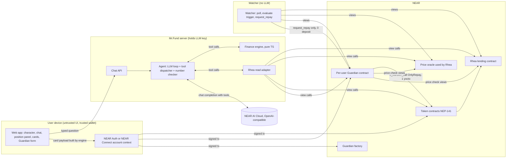
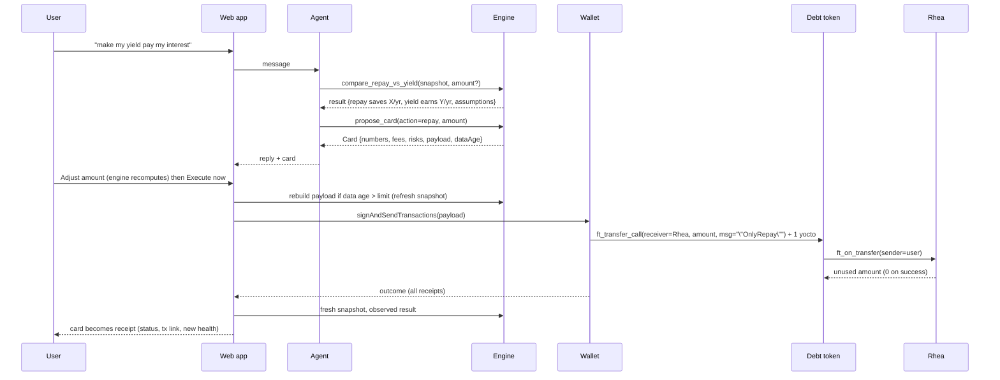
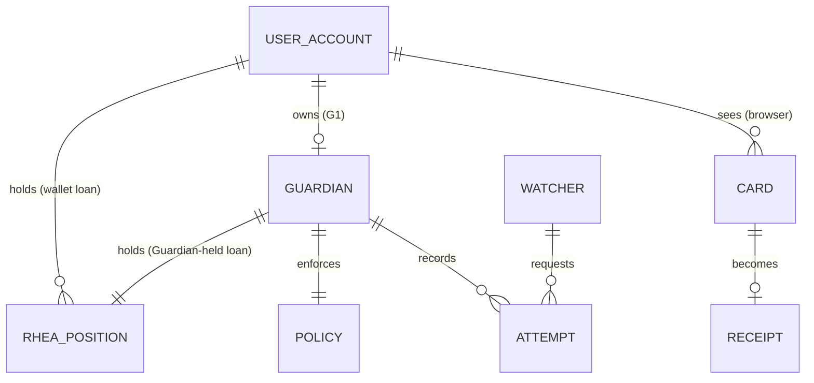

# Mr.Fund: architecture

## TL;DR and approval

- **Status: draft for unresolved network/provisioning.** D16 Option A was decided on 2026-11-05: Next.js App Router/Route Handlers, Rust Guardian and a separate Node watcher. User selected **G1 Guardian-held loan** (D18, 2026-11-07); the demo network (D19) remains open. These diagrams include planned components; current implementation/evidence is tracked in BUILD-PLAN, not implied by arrows.
- **Core invariant:** *the AI talks; deterministic code decides numbers; the contract decides permissions.* The LLM can read data and propose a card. It cannot build a transaction payload, sign anything, or reach the Guardian. Manual actions are signed by the user's wallet; automatic actions are requested by a deterministic watcher (no LLM in that path) and authorized only by the Guardian contract.
- **No private keys leave the user.** The watcher holds one function-call key that can call exactly one Guardian method and attach no deposit.

## System diagram and responsibilities



| Component | Inputs | Outputs | Owned state | Trust |
| --- | --- | --- | --- | --- |
| Web app | User input, wallet session, API responses | Rendered chat, cards, forms; transaction requests to the wallet | Chat transcript and receipts in browser storage | Untrusted for authority; displays only engine numbers |
| Wallet (NEAR Connect) | Transactions built by the engine | Signatures, transaction outcomes | User keys | Trusted by the user; Mr.Fund never sees keys |
| Dual-login module (D31) | Hosted Auth0 identity or NEAR Connect wallet accounts | Network-qualified selected account; no signer exposed in this slice | Provider-managed login state; network-scoped method/account hint only | Browser state is not server authentication or Guardian authority |
| Chat API | Message, account id, locale | Streamed assistant reply, card drafts, character state | None durable (stateless per request) | Holds the LLM key; rate-limited |
| Agent | Conversation, tool registry | Tool calls, final text, card drafts | None | LLM output is untrusted text |
| Finance engine | Snapshots, policies, parameters | Numbers with inputs and assumptions; typed errors | None (pure) | Source of truth for every number |
| Rhea read adapter | Account id, network config | `PositionSnapshot`, `MarketSnapshot`, Guardian views | None across requests; request-local block pinning only | Read-only |
| Watcher | Guardian list, policies, snapshots | `request_repay` calls; heartbeat; logs | Last evaluation per Guardian | Can only request; no LLM |
| Guardian factory | `create_guardian` from user wallet | New per-user Guardian account | Guardian code, registry of created accounts | Cannot act on existing Guardians |
| Guardian | Owner calls, watcher requests, token transfers | Rhea calls, events, views | Policy, reserve accounting, history | **Authority boundary for automatic actions** |
| Rhea lending | Token transfers and `execute` | Position changes | Positions | External; behavior proven in Phase 0 |
| Oracle | View calls | Prices with publish time | Prices | External; freshness enforced by consumers |

### Dual-login implementation boundary (D31)

[V, local, 2026-11-08] `apps/web/src/wallet/` implements explicit configuration, account validation, hosted identity-to-public-address derivation, NEAR Auth/NEAR Connect adapters and a framework-independent session controller. Per the user's later instruction, all UI-related integration is deferred: no React provider, root wiring, connection page or DESIGN work ships in this slice.

- `createWalletSession(network, adapters, storage?)` exposes `getSnapshot`, `subscribe`, `restore`, `login`, `selectAccount`, `logout` and `dispose`. Its state contains lifecycle status, nullable selected session and a sanitized error.
- The session contains method, network, accountId, validated account candidates and `contextKey`. Future frontend state must partition/reset by that key; it does not prove account ownership to a server.
- Provider state, not browser hints, establishes account context. A restored method/account hint cannot add accounts absent from the provider.
- Interactive login and sign-out are exclusive. Competing operations reject until they settle; do not queue popups and lose the user's gesture. Passive SDK events during login cannot supersede its final account read.
- Generation guards discard obsolete passive/disposed results. They are not a substitute for exclusion: the connector's delayed sign-out mutates global provider state before returning.
- Hosted Auth delegates identity validation to the official Auth0 browser SDK and uses the published network tenant/identity path to read the deployed MPC Ed25519 public key. An implicit address is neither a funded account nor evidence of transaction permission.
- No signing method, raw token, private key or backend authorization credential crosses the interface. Guardian permissions, manual wallet approval and public-read chat behavior are unchanged.

Observed module tests, the public MPC probe and remaining real-login gates are recorded in [INTEGRATIONS](INTEGRATIONS.md#dual-login-module-handoff-d31). React context and app-level login proof remain unchecked in `add-dual-near-auth`.


## Data flow

### Flow 1: ask and explain (F1, F2, F3)

1. User types a question in any language. The UI sends `{message, accountId, locale, guardianId?}` to the chat API.
2. The agent calls the LLM with the persona prompt, the conversation and the tool registry (see "Codebase structure and interfaces").
3. The LLM calls tools; the dispatcher validates arguments with a schema, runs the adapter and engine, and returns results that include every number with units and data age.
4. The LLM writes the reply in the user's language. The number checker compares every numeric token in the reply with the tool results. If a number has no source, the reply is regenerated once with the violation named; on a second failure, the reply is replaced with a template answer built from the tool results.
5. The character state is computed from the snapshot by the engine (PRD F1 table), never by the LLM.

### Flow 2: recommend and execute a manual repay (F4, F5)



Browser execution (`apps/web/src/execution/`, `add-wallet-manual-repay-execution`) [V, local tests 2026-11-10; no public wallet run yet]:

- **Permission boundary:** only the user's wallet signs. The signer exists only for NEAR Connect sessions (`NearConnectAdapter.signingWallet`); `WalletState`, `AuthAdapter` and NEAR Auth stay signer-free. The app holds no key and requests no access key or plugin.
- **Invariants:** E1 the wallet signs only a frozen `VerifiedRepay` issued by `verifyCardPayload` for the session account and network (the signer refuses any other object); E2 `confirmed` comes only from `toCardReceipt` over a parsed outcome with a fresh post-state, never from a thrown wallet error; E3 one submission per card, locked from the moment the wallet is asked; E4 a later failed or partial transaction never resets an applied repay; E5 NEAR Auth sessions cannot reach the signer.
- **Verifier allowlist:** repay `ft_transfer_call` to the configured lending contract with 1 yocto and the version's exact message; optional `storage_deposit` for the configured fee recipient (deposit ≤ 0.1 NEAR); `ft_transfer` of the card's fee to the configured recipient with 1 yocto. One function call per transaction with exactly the builder's keys; anything else is refused. Lending id and fee recipient come from `NEXT_PUBLIC_RHEA_LENDING_ID` and `NEXT_PUBLIC_FEE_RECIPIENT_ID` (no defaults).
- **Wallet errors:** observation decides. Unchanged debt → nothing observed; changed debt → an observed change, never `confirmed`; unreadable → unknown, card stays locked.
- **Negative tests:** extra AddKey/Transfer/DeployContract/Stake, wrong receiver, method, deposit, amount, message, fee recipient or fee amount, oversized registration, stale card, wrong network, foreign signer, forged unverified payload, Auth session, double activation, changed position, failed fresh read, wallet rejection, mismatched wallet result, unreadable outcome, recorded outcome fixtures.
- **Does not guarantee:** that the wallet's display is accurate, that a debt change is caused by this repay, or any public-network behavior before P4.5 evidence.

For a Guardian-held loan (G1), the same card targets the Guardian instead: `ft_transfer_call(receiver=<guardian>, amount, msg={"repay":{}})`, and the Guardian forwards the tokens to Rhea with `OnlyRepay` as itself. The execution fee, if any, is a separate `ft_transfer` to the fee recipient in the same `signAndSendTransactions` batch and is listed on the card.

### Flow 3: Guardian activation (F6, G1)

1. User fills in the form. The engine validates fields (PRD F6) and produces a plain-language summary plus the exact policy struct.
2. Wallet step 1: `create_guardian({policy})` on the factory with NEAR funding in `[min_funding, max_funding]` (floor 2.75325 NEAR for the current build [V, sandbox]) and at least 145 Tgas. The signer becomes the owner; the factory creates the next `get_next_guardian_id(owner)` account and its batch holds only create-account, transfer, deploy and `new` (**no access key**, I10). The watcher id and all other config come from the factory template, not from the call. The client shows the Guardian only after the `created` outcome or `guardian_created` event; `failed` returns `refund: sent | claimable`, and a claimable refund is taken with `claim_refund()` (1 yocto).
3. Wallet step 2: `owner_register({target_id, storage_deposit})` with 1 yocto, once each for the lending contract, the debt token and the collateral token. The storage deposit is paid from the Guardian's own NEAR. Each call holds the Guardian lock until its callback, so the targets are registered one transaction at a time.
4. Wallet step 3: `ft_transfer_call(receiver=<guardian>, amount=reserve+activation_fee, msg={"activate":{}})` on the debt token. The contract refunds the whole amount unless it covers activation fee + reserve floor + max per action + action fee. The Guardian books the reserve, forwards the immutable template activation fee to the fee recipient, and emits `activated`.
5. The loan: collateral via `ft_transfer_call(receiver=<guardian>, msg={"collateral":{}})`, then `owner_borrow(amount)`. Borrowed tokens arrive at the Guardian, and `owner_sweep` sends everything above the booked reserve to the owner (SMART-CONTRACT). The user decided on 2026-11-11 that P0 will offer these steps in the UI; implementation remains open (`add-guardian-live-activation-ui` task 5.5).
6. The watcher operator adds a function-call key on the watcher account restricted to `receiver_id = <guardian>`, `method_names = ["request_repay"]`, with a finite gas allowance.

Each step's progress is read back from chain (`get_guardian(owner)`, `is_pending`, `get_unclaimed`, `get_status`, registrations); no step is assumed atomic with the next.

### Flow 4: Guardian trigger, accept and reject (F6, F7)

```mermaid
sequenceDiagram
  participant WA as Watcher
  participant G as Guardian
  participant O as Oracle
  participant R as Rhea
  participant T as Debt token
  WA->>WA: engine.evaluateTrigger(snapshot, policy) => repay amount A
  WA->>G: request_repay(A) [FC key, 0 deposit]
  G->>G: auth, status, in-flight, cooldown, A<=max, cap, floor
  alt any policy check fails
    G-->>WA: Rejected{reason}; event request_rejected; history row
  else checks pass
    G->>R: get_account(self), get_assets(...)
    G->>O: get_price_no_older_than(id, age) per asset
    G->>G: on_trigger_checked: health < trigger? prices fresh?
    alt trigger not met or stale
      G-->>WA: Rejected{trigger_not_met | stale_price}
    else
      G->>G: lock in-flight {A, fee}
      G->>T: ft_transfer_call(Rhea, A, "\"OnlyRepay\"") + 1 yocto
      T->>R: ft_on_transfer(sender=Guardian)
      G->>G: on_repay_resolved: used, refunded; release lock; charge fee if used>0
      G-->>WA: Executed{used, fee}; event repay_settled
    end
  end
```

The over-limit beat in the demo is the first branch: a request with `A > max_per_action` is rejected by the contract, and the rejection transaction is shown. If D27 falls back, the trigger-check calls are omitted and the per-action fee is zero.

### Flow 5: failures

| Failure | Detection | User-visible state | Recovery or terminal state | Planned test |
| --- | --- | --- | --- | --- |
| RPC unavailable | Adapter error | Position panel "Can't reach NEAR right now"; character concerned | Retry button; no advice on stale data | Adapter unit test with failing transport |
| Price stale (older than its limit) | Engine freshness check | Numbers greyed, "price is N min old"; Execute disabled | Refresh; if still stale, no card | Engine test with old `publishTime` |
| LLM down or slow | API timeout | "Mr.Fund can't talk right now"; panel and cards still work | Retry; template answers for core questions | API test with failing provider |
| LLM invents a number | Number checker | Reply regenerated or replaced by template | Logged as a checker hit | Agent test with a scripted bad reply |
| Wallet rejects | Wallet error | Card back to draft with "You cancelled" | User can retry | E2E with fake wallet adapter |
| Transaction fails on-chain | Outcome parser finds a failed receipt | Card shows failed + reason + link | User decides; no automatic retry | Builder and parser tests with recorded failure outcomes |
| Partial batch | Some transactions in a batch fail | Receipt lists each transaction's status | Explicit per-step state | Parser test |
| Watcher down | Heartbeat older than 2 polling intervals | Guardian panel "Watcher offline since …"; F7 answers it | Operator restarts; contract unaffected | Watcher heartbeat test |
| Reserve exhausted | Spendable < minimum repay | Guardian panel and chat warn | User tops up or deactivates | Contract and watcher tests |
| Rhea repay refunds part | `ft_resolve_transfer` returns unused | Receipt shows used and refunded | Refund returns to reserve | Sandbox test |

## Selected stack and historical alternatives (D16)

D16 selected Option A on 2026-11-05; Option C below is historical comparison, not an active implementation track. [OPEN-DECISIONS D16](../OPEN-DECISIONS.md#d16-tech-stack-open) records the decision. Table versions are observations from 2026-11-04; installed versions/deviations and local verification are recorded in BUILD-PLAN P0.7 and subsequent evidence.

| Layer | Option A (recommended) | Option C | Version source (2026-11-04) |
| --- | --- | --- | --- |
| Runtime | Node 24.22.2 | Node 24.22.2 (tooling), Workers runtime | `nodejs.org/download/release/latest-v24.x/SHASUMS256.txt` |
| Language | TypeScript 7.0.2 | same | `npm view typescript version` |
| UI | React 19.3.1, React DOM 19.3.1 | same | `npm view react version`; `npm view react-dom version` |
| Web framework | Next.js 16.4.5 (App Router, Route Handlers) | Vite 8.3.5 + `@vitejs/plugin-react` 6.2.1 | `npm view next version`; `npm view vite version` |
| Server for chat | Next Route Handlers | Cloudflare Worker `fetch`, Wrangler 4.157.0 | `npm view wrangler version` |
| Watcher | Separate Node process (always-on host) | Worker Cron `scheduled` | Cloudflare limits page; Railway, Fly.io pricing pages |
| Wallet | `@hot-labs/near-connect` 0.12.0 | same | `npm view @hot-labs/near-connect version`; docs.near.org/tools/near-connect |
| RPC and service signing | `near-api-js` 7.4.0 (requires Node ≥ 22.22.2) | same, Worker compatibility unproven | `npm view near-api-js version engines` |
| LLM client | `openai` 7.50.0 against `https://cloud-api.near.ai/v1` | same | `npm view openai version`; docs.near.ai/cloud/guides/openai-compatibility |
| Contract | Rust `near-sdk` 5.30.0 (MSRV 1.95), Rust stable 1.99.1 | same | crates.io API; static.rust-lang.org stable channel |
| Contract build | `cargo-near` 0.22.0 (stable) | same | crates.io API |
| Contract tests | `near-workspaces` 0.24.0 (Linux/macOS sandbox; WSL2 on Windows) | same | crates.io API; near-workspaces-rs README |
| Unit tests | Vitest 5.1.0 | same | `npm view vitest version` |
| E2E | `@playwright/test` 1.64.1 | same | `npm view @playwright/test version` |
| Money math | Native `BigInt` in atomic units | same | MDN BigInt |

Rejected for the Guardian: Option B (function-call key plus server policy), because function-call keys cannot attach the 1 yoctoNEAR that `ft_transfer_call` and Rhea `execute` require.

Character rendering candidates (D26): sprite sheets with CSS; `lottie-react` 3.1.2; `@lottiefiles/dotlottie-react` 0.21.1; `@rive-app/react-canvas` 4.38.0; SVG with `motion` 14.9.1; SVG with `gsap` 3.15.1.

## Codebase structure and interfaces

Selected Option A layout: `apps/web` hosts the chat API as Route Handlers under `src/app/`, and `apps/watcher` is a Node process. Since 2026-11-14 the handlers live in `packages/server` and `apps/api` can serve them standalone (see CHAT-API "Standalone API server"); `packages/server` may import `agent`, `engine`, `guardian-client`, `rhea` and `shared`, and `apps/web` and `apps/api` import it. The Option C edge layout in the historical comparison is not implemented.

```text
apps/
  web/                    UI and (Option A) chat API
  watcher/src/core/       pure evaluation loop, runtime-agnostic
  watcher/src/main.ts     Option A process entry
  edge/                   Option C only
packages/
  shared/                 types: units, snapshots, cards, policy, errors
  engine/                 F3 pure finance functions
  rhea/                   F2 view reads + transaction builders for Rhea and tokens
  guardian-client/        typed views and transaction builders for Guardian and factory
  agent/                  persona prompt, tool registry, dispatcher, number checker
contracts/
  guardian/               Rust near-sdk Guardian
  guardian-factory/       Rust near-sdk factory
  tests/                  near-workspaces sandbox tests (Rust)
fixtures/                 recorded RPC responses, labelled with network, block and date
scripts/                  Phase 0 probes and demo operator scripts
```

Import rules: `engine` imports only `shared`. `rhea` and `guardian-client` import `shared` and the RPC client. `agent` imports `engine`, `rhea`, `guardian-client` and `shared`, and never a signer. The watcher imports `engine`, `rhea`, `guardian-client` and its own signer; it never imports `agent`. Transaction builders exist only in `rhea` and `guardian-client`.

The D31 login slice lives in `apps/web/src/wallet/` and `/connect`, outside agent/server/watcher imports. Auth0's official browser SDK performs NEAR Auth login; the MPC public-key view maps its authenticated subject to an implicit address without creating or funding it. NEAR Connect supplies ecosystem accounts. The shared context exposes no signing API. Mainnet Auth approval, real login proof and wallet transaction submission have separate evidence gates in `add-dual-near-auth`; see its design for exact path/configuration and upstream SDK compatibility findings.

### Core types (TypeScript, `packages/shared`)

```ts
type AccountId = string;            // NEAR account id, validated
type Atomic = bigint;               // token atomic units, never Number
type Bps = number;                  // integer basis points, 10000 = 100%

interface TokenMeta { id: AccountId; symbol: string; decimals: number; extraDecimals: number }
interface Price { multiplier: bigint; decimals: number; publishTimeMs: number | null; source: "oracle" | "default_price" }

interface AssetState {
  token: TokenMeta;
  volatilityRatioBps: Bps;          // Rhea asset config volatility_ratio (10000 scale)
  supplyAprBps: Bps; borrowAprBps: Bps;  // supply_apr floors, borrow_apr ceils to integer bps (D30)
  canBorrow: boolean; canUseAsCollateral: boolean;
}

interface PositionSnapshot {
  network: "testnet" | "mainnet";
  lendingId: AccountId; accountId: AccountId; blockHeight: number; readAtMs: number;
  collateral: { tokenId: AccountId; internal: Atomic }[];   // Rhea internal units (token atomic * 10^extraDecimals)
  supplied:   { tokenId: AccountId; internal: Atomic }[];
  borrowed:   { tokenId: AccountId; internal: Atomic }[];
  assets: Record<AccountId, AssetState>;
  prices: Record<AccountId, Price>;
}

type EngineError =
  | { kind: "stale_price"; tokenId: AccountId; ageMs: number; limitMs: number }
  | { kind: "missing_price"; tokenId: AccountId }
  | { kind: "unsupported_asset"; tokenId: AccountId }
  | { kind: "invalid_amount"; reason: string };

interface Computed<T> { value: T; inputs: Record<string, string>; assumptions: string[]; dataAgeMs: number }
```

### Rhea read adapter (`packages/rhea`, P1.4)

P4.2 compatibility update [V, 2026-11-06]: manual repay builders require the observed `lendingVersion` and token `extraDecimals`. The agent's trusted `ProposalContext` supplies the version; LLM tool arguments cannot choose it. Version 0.16.2 uses `OnlyRepay`; 0.11.0 uses a fixed `Execute`/`Repay.max_amount` message, with inner units checked against u128. Unknown versions refuse without retries or guesses. `max_amount` is necessary for rounded full repayments: strict `amount` above subatomic debt failed on deployed testnet bytecode. Accepted excess may remain supplied, so token acceptance is not itself proof of debt reduction or refund.

[V, 2026-11-06] `createRheaClient(rpcUrl, fetchImpl?)` provides `view(contractId, method, args, blockId?) -> Promise<Result<{data: unknown, blockHeight, blockHash}, AdapterError>>`. Contract data is validated rather than trusted through a generic cast. One JSON-RPC object per POST, a 10 s request timeout, no signing or batching. UTF-8/base64 works without a browser Buffer polyfill.

`readPosition(client, {network, lendingId}, accountId)` returns `Promise<Result<PositionSnapshot, AdapterError>>`; `readMarket(client, config)` returns `Promise<Result<MarketSnapshot, AdapterError>>`. Both expose `rpc_unavailable` or `bad_response`, clarifying the earlier unspecified/throwing market signature. `MarketSnapshot` contains network, lending id, block height, read time, assets, prices and `unsupportedTokenIds`.

The config read anchors a final block hash; subsequent paginated asset, account, metadata, oracle and derivative views use that hash. No cache is implemented. `readAtMs` is the start of the read, so network latency cannot make balances younger. Unknown position assets remain in balances but lack metadata, causing the engine to refuse advice. Missing Pyth mappings mark assets unsupported. Invalid responses and failed metadata views are errors. Null oracle prices are omitted (`missing_price` in the engine); old non-null prices retain their publish time for freshness checks. Only Pyth-enabled configs and regular lending positions are supported.

[I, explicit no-cache decision, 2026-11-10, add-position-read-api] The responsibilities table previously proposed a short block-height cache, contradicting this section's no-cache implementation. That proposal is removed: low expected traffic does not justify unseen stale balances, and post-repay refresh must initiate another final-block snapshot. GET/POST `/api/position` and its downstream fetches use `Cache-Control: no-store` / `cache: "no-store"`; every admitted request reads anew. Request-local pinned blocks are not a cache. Responses expose actual source/time/data age; HTTP success does not imply oracle truth or future freshness. Endpoint interface and deployment limits are in [INTEGRATIONS](INTEGRATIONS.md#public-position-read-configuration).

[V, D30, 2026-11-06] Rates retain Rhea's `supply_apr`/`borrow_apr` convention without APR/APY conversion. Decimal strings convert with integer arithmetic: supply floors and borrow ceils to basis points. Engine horizon estimates are linear, with no claim to model protocol compounding. Pyth conversion mirrors the published source: floor to `fraction_digits`, decimals = token decimals + fraction digits; derivative adjustments use `price * adjustment / 10^24`. Fixed prices retain `publishTimeMs: null` and `source: default_price`. Deployed-code parity and agreement with the Rhea UI remain separate checks.

### Engine functions (`packages/engine`, pure)

```ts
healthBps(s: PositionSnapshot, nowMs: number): Result<Computed<Bps | "no_debt">, EngineError>
liquidationPrice(s: PositionSnapshot, collateralTokenId: AccountId, nowMs: number): Result<Computed<Price>, EngineError>
maxRepayUseful(s: PositionSnapshot, debtTokenId: AccountId, nowMs: number): Result<Computed<Atomic>, EngineError>   // outstanding debt, rounded up
repayVsYield(s: PositionSnapshot, p: { amount: Atomic; tokenId: AccountId; yieldAprBps: Bps; horizonDays: number }, nowMs: number): Result<Computed<{ amountUsed: Atomic; repaySaves: Atomic; yieldEarns: Atomic; winner: "repay" | "yield" | "equal" }>, EngineError>
whatIfPrice(s: PositionSnapshot, shocks: { tokenId: AccountId; changeBps: number }[], nowMs: number): Result<Computed<{ healthBps: Bps | "no_debt"; liquidatable: boolean }>, EngineError>
repayToReachHealth(s: PositionSnapshot, debtTokenId: AccountId, targetBps: Bps, nowMs: number): Result<Computed<Atomic>, EngineError>
evaluateTrigger(s: PositionSnapshot, policy: GuardianPolicy, guardian: GuardianState, nowMs: number): Result<{ act: false; reason: string } | { act: true; amount: Atomic }, EngineError>
fees(action: CardAction, schedule: FeeSchedule): Computed<FeeLine[]>
```

Rhea formulas implemented [V, burrowland source at `2110c70`, read 2026-11-04]:

- Adjusted collateral `C = Σ value(collateral_i) × r_i`; adjusted debt `B = Σ value(debt_j) / r_j`; `r = volatility_ratio / 10000`; health `= C / B`. Supplied, non-collateral balances are excluded. Collateral share conversion rounds down; debt rounds up.
- `value = internal_balance × price.multiplier / 10^(price.decimals + extra_decimals)`; internal amount = token atomic amount × `10^extra_decimals`.
- Liquidation is possible only while the discount `(B − C) / B / 2` is positive (health strictly below 100%).

The engine rounds health down and debt up. Verification is split: shared-vector parity, actual deployed-code risk/discount behavior in local sandbox, and public display comparison. [PROTOCOL-EVIDENCE](PROTOCOL-EVIDENCE.md) records the 2026-11-07 observations and bounded source-model rounding differences. Public UI parity and the legacy deployment's scalar health remain unverified; local checks do not establish a universal 1-bp bound.

### Tool registry (`packages/agent`)

| Tool | Arguments (validated) | Returns | Side effects |
| --- | --- | --- | --- |
| `get_position` | none (account from validated server public-read context, not authentication) | Snapshot summary with health, liquidation price, data age | None |
| `compare_repay_vs_yield` | `amount?`, `horizonDays` (default 365) | `repayVsYield` result | None |
| `what_if_price` | `shocks[]` (bounded −95% to +500%) | `whatIfPrice` result, labelled scenario | None |
| `propose_card` | `action` (enum), `amount?` | Card built by the engine, or a typed refusal | Creates a draft card shown in the UI; no signing |
| `guardian_status` | none | Validated status/policy/reserve/config, block provenance; correlated heartbeat observation or explicit unavailable | None |
| `guardian_history` | `sinceMs?`, `limit` 1–50 | Backend-filtered retained attempts/reasons and known spend/fees; truncation and unavailable transaction links disclosed | None |
| `quote_opening` | `target_health_percent?` | Engine maximum additional borrow, target, collateral in Rhea, wallet balance, APR, health, data age | None |
| `propose_opening` | `stage` (deposit or borrow), `amount`, `token?`, `target_health_percent?` | One draft opening card built by the engine and the Rhea builders, or a typed refusal | Creates a draft card shown in the UI; no signing |
| `explain_term` | `term` (enum of glossary terms) | Short fixed explanation | None |

No tool signs, sends, changes a policy or calls the watcher. A card's payload is created by `rhea` or `guardian-client` builders from engine-validated parameters; the LLM's text never becomes payload bytes.

Guardian read integration (local, 2026-11-07): `guardian-client` has an injected structural `GuardianViewClient` and a bounded public RPC implementation. `readGuardian` anchors `get_config` at finality `final`, pins status/policy/reserve/the complete retained ring to that block hash, rejects mixed provenance and validates actual Rust decimal-string u128/U64, snake_case enums, operation phases, policy and reserve arithmetic. Nanoseconds remain bigint; `nsToMs` checks conversion. `toGuardianState` explicitly maps the engine input. These are public reads, not authentication or on-chain code-hash verification.

`dispatch` always returns `Promise<ToolResult>`; every caller awaits it, including formerly synchronous tools. The server injects `ToolContext.guardian` with a trusted network/account target and optional heartbeat dependency. Model arguments cannot choose contracts, owners, network, recipients or hashes. Tools correlate the Guardian owner/network/lending target and debt-token metadata with trusted snapshot context before emitting SourceNumbers. `sinceMs` is inclusive; filtering and latest-limit selection happen in the backend after reading at most 50 retained attempts. An empty result never proves no past activity.

Chat runtime integration (2026-11-08): `runChatTurn` composes the awaitable dispatcher, current-turn source facts, bounded provider calls and pre-emission guards. `apps/web/src/app/api/chat/route.ts` constructs the real read-only context and native-fetch OpenAI-compatible provider from server environment. Request/account selection does not prove ownership; no signer or transcript database was added. The response is SSE progress followed by guarded text, unsigned cards and a terminal summary. See [CHAT-API](CHAT-API.md) for request/event contracts, cancellation, proxy/rate-limit boundaries, exact GLM settings and offline/live evaluation.

Heartbeat evidence must match network/Guardian/current watcher and ordered nonfuture `lastSeenMs`/`observedAtMs`; more than 90 seconds since last seen yields `stale_observation`, otherwise `recent_observation`. Missing, malformed or failed observations remain unavailable; neither state proves uptime or a historical cause. Attempts lack transaction hashes and activation metadata, so no explorer link or paid-activation fee/date is inferred. Configured activation fee is explicitly separate from historical payment. Pending/unresolved placeholder zeros never become factual zero consumption or confirmed zero fees; only known accepted spend and terminal confirmed fees enter numeric facts. Full F7 event-link/activation-fee evidence remains open until a verified source is connected.

Existing-instance owner controls: `guardianOwnerPayload` builds only fixed-target pause/resume/deactivate/withdraw/policy/rotation calls with 1 yocto and the current Rust ABI. It validates owner binding, a nonfuture read age no greater than 120 seconds, status transitions, shared locks, policy bounds and cumulative-spend floor. Owner withdrawal remains available after deactivation and may cross the automation reserve floor. `guardianOwnerCard` produces engine-owned deactivate/withdraw drafts from validated state; `propose_card` supports those two actions using a fresh server read. Reason prose never changes amounts or recipients, and payload bytes stay out of the tool message. These are unsigned existing-instance drafts, not proof of live execution or a deployed factory.

Activation is deliberately unavailable: `guardianOwnerPayload({kind:"activate",…})` refuses until the final provisioning ABI is verified; the tool registry does not advertise it. No registration/create/fund sequence, factory method or funding amount is guessed. User requested stopping at client/tools; the separate factory work remains outside this merge. OpenSpec conditional tasks stay open, so the change is not archived while activation/provisioning tests are incomplete.

Plain-wallet opening (local, 2026-11-13): `quote_opening` and `propose_opening` read their inputs from `ToolContext.opening`, which the server fills lazily through `ToolContext.openingLoader` only when the model calls one of them (a block-pinned `readOpenPositionContext` plus the fee recipient registration). No config, a failed read or a missing fee policy answers `not_available` or `fee_policy_missing`; nothing is guessed. The browser side is `apps/web/src/execution/open-position-live.ts` (store), `useLiveOpening` and `play/OpeningExecution.tsx`: prepare re-reads and verifies the card, shows the in-app confirmation, then one wallet request per card; results come only from the reconciler. Imports follow the existing rules: `agent` imports no signer, `rhea` does not import `engine`, the store imports the runner, verifier and signer from `apps/web/src/execution`. Deposit and borrow are separate cards; the borrow card exists only for collateral Rhea already holds. Not exercised in a real wallet yet; see `openspec/changes/add-chat-open-position/handoff.md`.

### Card (`packages/shared`)

P4.3 backend update [V, local, 2026-11-07]: `packages/rhea` exports a pure outcome parser, bounded read-only outcome RPC adapter, ordered batch aggregation and fresh position reconciliation. Execution, token acceptance/refunds and debt/supplied deltas remain separate. `toCardReceipt` confirms repayment only when the entire batch succeeds and a valid post-read observes debt reduction; terminal execution without post-state stays separately visible as execution evidence while the receipt remains submitted. Health is injected from the deterministic engine by the composition root. Full API, limits, receipt mapping and sandbox fixture provenance: [REPAY-OUTCOMES](REPAY-OUTCOMES.md). Wallet/UI integration remains incomplete.

```ts
type CardAction = "repay" | "guardian_activate" | "guardian_deactivate" | "guardian_withdraw" | "wallet_collateral_deposit" | "wallet_borrow";
interface Card {
  id: string; action: CardAction; headline: string;
  reason: string;                       // LLM text, number-checked
  numbers: { label: string; before?: string; after?: string; unit: string }[];
  assumptions: string[]; fees: FeeLine[]; risks: string[];
  dataAgeMs: number; maxDataAgeMs: number;
  payload: NearTransaction[];           // built by rhea/guardian-client only
  receipt?: { status: "submitted" | "confirmed" | "failed" | "partial"; txHashes: string[]; observed?: Record<string, string>; atMs: number };
}
```

## ERD and data model

P0 needs no database. Durable truth lives on-chain; the browser keeps the conversation and receipts; the watcher keeps an in-memory evaluation log.



| Entity | Where | Key fields and units | Sensitivity and retention |
| --- | --- | --- | --- |
| Rhea position | Rhea contract | Supplied, collateral, borrowed shares and balances (internal units) | Public on-chain |
| Guardian | Per-user contract account | Owner, watcher, lending id, oracle id, debt token, fee recipient, status | Public on-chain |
| Policy | Guardian state | `max_per_action`, `lifetime_cap`, `reserve_floor` (atomic), `trigger_hf_bps`, `target_hf_bps`, `cooldown_sec`, `action_fee` | Public on-chain |
| Attempt | Guardian state (last 50) and events (all) | `op_id`, time, amount, outcome, reason, fee | Public on-chain |
| Card and receipt | Browser storage keyed by account and network | Card fields; tx hashes | Private to the device; user can clear |
| Chat transcript | Browser storage; sent per request | Messages | Private; not stored server-side in P0; provider retention per NEAR AI terms [U] |
| Watcher log | Watcher memory and stdout | Evaluations, requests, errors (no secrets) | Operator-only; rotated |

## Security model

**Assets:** user collateral and debt position; the Guardian reserve; the user's wallet keys; the watcher function-call key; the LLM API key; the user's trust in the numbers.

**Adversaries:** a prompt injector (user text, token symbols or metadata that try to steer the LLM); a compromised or buggy watcher; a compromised Mr.Fund server; a malicious fee recipient change; a stale or manipulated oracle; front-end tampering; a griefer calling Guardian methods.

**Authority matrix:**

| Action | User wallet | Mr.Fund server / LLM | Watcher | Guardian contract |
| --- | --- | --- | --- | --- |
| Manual repay from wallet | Signs | Proposes card only | No | n/a |
| Create Guardian, fund reserve, change policy, pause, deactivate, withdraw, borrow, sweep | Signs (owner only) | Proposes card only | No | Enforces owner check |
| Automatic repay | No | No | Requests via `request_repay` | Decides; enforces policy |
| Change watcher | Signs `rotate_watcher` | No | No | Enforces owner check |

**Threats and controls:**

| Threat | Control | Residual risk |
| --- | --- | --- |
| Prompt injection makes Mr.Fund "execute" something | LLM has no signing tool; payloads are built by deterministic builders from validated enums and bounded amounts; every execution needs a wallet signature shown by the wallet | User could still approve a card they misunderstood; cards show plain numbers and the wallet shows the call |
| Prompt injection via token metadata or chat history | Tool results are data, passed as tool messages; symbols are rendered, never interpreted; number checker blocks invented numbers | Misleading prose is possible; numbers stay correct |
| Stale oracle | Engine refuses advice on stale inputs; Guardian (D27) rejects stale prices; Rhea rejects stale prices for priced actions | Fast markets can move between check and execution |
| Watcher down | Heartbeat shown in the panel and in F7 answers; contract unaffected | Liquidation can happen while the watcher is down; disclosed |
| Watcher key leak | Key restricted to one receiver and `request_repay`, no deposit possible; contract enforces caps, floor, cooldown, lifetime cap and target | An attacker can trigger repays within the user's limits (debt goes down); the per-action fee is bounded by cooldown and lifetime cap, or zero under the D27 fallback |
| Reserve drain | Floor, per-action max, lifetime cap, single in-flight lock, refunds return to reserve; reserve can leave only to Rhea (repay), the fixed fee recipient (bounded fee) or the owner | Bugs in unaudited code; tests and review in P2.7 and P6.1 |
| Fee transparency | Fees and recipient are in the signed policy and on every card; fee recipient fixed at Guardian creation | Pricing itself is open (D24) |
| Guardian upgrade or key backdoor | Guardian accounts are created with no access keys and no upgrade method; the factory can change code only for new Guardians | Factory code bugs at creation time |
| Server compromise | Server holds only the LLM key and read access; cannot sign for users or the Guardian | Could show wrong text; numbers on cards are recomputed client-side from a fresh snapshot before Execute (P4.1) |
| Front-end tampering | The wallet displays receiver, method and amount before signing | User must read the wallet prompt |

**Banned claims:** never get liquidated, guaranteed yield, safe, risk-free, free borrowing. The PRD "Risks and guarantees" list is the single source; SMART-CONTRACT repeats only the contract-level subset.

## Deployment and verification

| Environment | Purpose | Status |
| --- | --- | --- |
| Local unit tests | Engine, builders, agent checker, contract unit tests | Exercised; detailed results in BUILD-PLAN |
| Local sandbox (`near-workspaces`) | Probe + imported Rhea 0.11.0/0.16.2 + test tokens/Simulated oracle; Guardian policy/reserve | Exercised; factory and automatic Guardian flow remain incomplete |
| NEAR testnet | Phase 0 probes, Guardian deployment, demo (D19 ladder steps 1 and 2) | Planned |
| NEAR mainnet | Read-only engine validation; deployment only if the founder approves D19 step 3 | Planned, approval-gated |

Verification commands (actual run summaries are in BUILD-PLAN; commands alone are not evidence):

- `cargo test -p guardian` (contract unit tests), `cargo test -p contract-tests` (sandbox, Linux or WSL2).
- `cargo near build non-reproducible-wasm` for development and `cargo near build reproducible-wasm` before any deployment.
- Package unit tests: `vitest run` in each `packages/*` (exact runner script per D16).
- `playwright test` for UI flows with the fake wallet adapter.

Observed evidence includes public read-only adapter recordings, local TypeScript/Rust tests and sandbox cycles on imported deployed Rhea code with new state and Simulated prices. No public deployment or live wallet repayment is claimed. D18 is G1 as of 2026-11-07; D19 and public funding/deployment gates remain open.

## Sources

All read 2026-11-04 unless stated.

- Rhea lending source `ref-finance/burrowland` @ `2110c7047f2d72a9189abcbaad5eafb4e4a87f9e`: `contracts/contract/src/actions.rs`, `actions_pyth.rs`, `actions_only.rs`, `fungible_token.rs`, `pyth.rs`, `position.rs`, `asset_config.rs`, `big_decimal.rs`, `storage.rs`, `account.rs`.
- Live RPC views via `https://test.rpc.fastnear.com` and `https://free.rpc.fastnear.com`: `get_version`, `get_config`, `get_assets_paged`, `get_all_token_pyth_infos`, `storage_balance_bounds`; `pyth-oracle.testnet` `get_price_no_older_than`.
- Rhea guide: https://guide.rhea.finance/developers/contracts.md ; health factor, liquidations and oracle pages.
- NEAR access keys: https://docs.near.org/protocol/accounts-contracts/access-keys.md ; one yocto: https://docs.near.org/smart-contracts/security/one_yocto.md
- NEAR Connect: https://docs.near.org/tools/near-connect.md ; wallet login tutorial: https://docs.near.org/web3-apps/tutorials/wallet-login.md
- NEAR AI Cloud: https://docs.near.ai/cloud/guides/openai-compatibility.md ; https://cloud-api.near.ai/v1/models
- Package and toolchain versions: commands listed in the stack table.
- Unverified prerequisites: deployed-code parity (B3), testnet price freshness (B2), in-contract trigger check (B4), Worker signing (Option C only).
