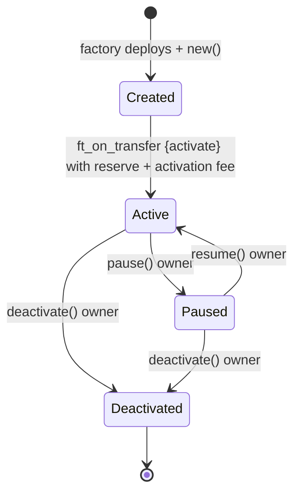

# Mr.Fund: smart contract specification

This is the interface contract among the Guardian implementation, its clients (web app, watcher) and its tests. It is not a claim of deployment or audit. **Status: draft for custody option G1** (OPEN-DECISIONS D18, recommended, not yet chosen). Under G2 no Guardian contract is deployed. Every Rhea call below is from the published source `ref-finance/burrowland` @ `2110c7047f2d72a9189abcbaad5eafb4e4a87f9e` (package `0.15.7`); the deployed versions differ (`0.11.0` testnet, `0.16.2` mainnet) and are proven in BUILD-PLAN P0.3 before this spec is final.

## TL;DR and necessity

- **Chain:** NEAR (testnet first, D19). Two contracts: `guardian-factory` (one per deployment) and `guardian` (one per user, created by the factory as `<label>.<factory>`).
- **Why on-chain:** the user's limits must bind even if the watcher, the Mr.Fund server or the LLM misbehaves. Rhea repays only the caller's own debt (D18), so the Guardian must hold the protected loan itself and enforce the policy where the money is.
- **Guarantee:** an automatic repay happens only through `request_repay`, only from the authorized watcher or the owner, only of the one configured debt token into the one configured lending contract, never above `max_per_action`, never pushing cumulative spend above `lifetime_cap`, never leaving the reserve below `reserve_floor`, never inside the cooldown, never while paused or deactivated, and (D27 preferred path) only when the contract itself measured health below the trigger with fresh prices.
- **Limit (does NOT guarantee):** it reduces liquidation risk within the user's limits; it cannot prevent liquidation. Fast price moves, stale or failing oracles, an insufficient reserve, watcher downtime, network congestion, Rhea behavior and bugs in this unaudited code can all leave the loan liquidated or funds lost.

## Storage and state machine

P2.1 implementation [V, 2026-11-06]: `new(config: GuardianConfig, policy: Policy)` groups immutable ids internally and initializes `created`. Enums serialize snake_case to match shared TypeScript; amounts, op ids and nanosecond times are decimal strings. `set_policy` also requires `lifetime_cap >= spent_total`, preserving I3 across updates. History `from` indexes the retained ring and `limit` clamps to 50. P2.2 below adds the token receiver and reserve lifecycle; automatic repay, upgrade and access-key methods are absent. Keyless factory creation remains separate evidence.

P0.4 read-only evidence [V, 2026-11-06]: joined position/config/feed/price reads reproduce shared engine vectors exactly, with null/expired/future prices rejected and derivative `extra_call` positions unsupported. Read-only gas burnt was 30.586–32.106 Tgas. Composed prototype evidence [V, 2026-11-07]: both imported 0.11.0 and 0.16.2 execute reads → repayment → resolver → fee callback with a 300 Tgas root allocation, including full-refund, token-failure and fee-failure paths. These use sandbox tokens and Simulated prices; they do not establish production token/oracle gas performance, liquidation protection or public deployment readiness. See [settlement evidence](GUARDIAN-SETTLEMENT.md). D18/D19/B7 remain open; no watcher-only D27 fallback has been selected.

Units: token amounts are `U128` atomic units of that token (JSON decimal strings). Health and thresholds are basis points, `u32`, where 10000 = 100%. Time is nanoseconds from `env::block_timestamp()` stored as `u64`; durations in policy are seconds.

### Guardian

```rust
#[near(contract_state)]
pub struct Guardian {
    owner_id: AccountId,            // set at init; never changes
    watcher_id: AccountId,          // may request_repay; owner can rotate
    lending_id: AccountId,          // Rhea lending contract; immutable
    oracle_id: AccountId,           // price source used by lending (pyth-compatible); immutable
    debt_token_id: AccountId,       // the only token the Guardian repays with; immutable
    collateral_token_ids: Vec<AccountId>, // allowed collateral tokens (P0: exactly one); immutable
    fee_recipient_id: AccountId,    // immutable
    policy: Policy,
    status: Status,                 // Active | Paused | Deactivated
    reserve: u128,                  // booked reserve in debt-token atomic units
    spent_total: u128,              // cumulative repaid + action fees since activation
    in_flight: Option<InFlight>,    // at most one automatic action at a time
    last_action_started_ns: u64,
    next_op_id: u64,
    history: VecDeque<Attempt>,     // last 50 attempts; full record in events
}

#[near(serializers = [json, borsh])]
pub struct Policy {
    max_per_action: U128,           // > 0
    lifetime_cap: U128,             // >= max_per_action
    reserve_floor: U128,            // Guardian never spends below this
    trigger_hf_bps: u32,            // >= MIN_TRIGGER_HF_BPS (10500)
    target_hf_bps: Option<u32>,     // > trigger_hf_bps if set; advisory for the watcher's sizing
    cooldown_sec: u32,              // >= MIN_COOLDOWN_SEC (300)
    action_fee: U128,               // per settled automatic repay; 0 under the D27 fallback
}

pub struct InFlight { op_id: u64, amount: u128, fee: u128, started_ns: u64 }
pub struct Attempt { op_id: u64, at_ns: u64, requested: U128, outcome: Outcome, reason: Option<RejectReason>, used: U128, fee: U128 }
pub enum Outcome { Rejected, Started, Settled, Failed, Unresolved }
pub enum RejectReason {
    NotActive, InFlight, Cooldown, ZeroAmount, AboveMaxPerAction, AboveLifetimeCap,
    BelowReserveFloor, TriggerNotMet, StalePrice, UnsupportedPositionShape,
    InvalidConfig, BadResponse, ArithmeticOverflow,
}
```

Constants: `MIN_TRIGGER_HF_BPS = 10500`, `MIN_COOLDOWN_SEC = 300`, `HISTORY_LEN = 50`. These are lead proposals [I] (D28) and are measured against gas in P2.7.

Settlement ABI additions (local rebuild required): immutable `GuardianConfig` additionally requires `lending_version: String` (exactly `0.11.0` or `0.16.2`), `debt_extra_decimals: u8`, `collateral_extra_decimals: u8` (both ≤38), `collateral_price_id: String`, `debt_price_id: String` (64 hex characters), and `max_price_age_sec: u32` (1–3600). `get_config()` exposes this snapshot. Runtime reads must match version, both asset extra-decimal values, oracle id, feed ids and Rhea's freshness limit before dispatch. Unknown/mismatched configuration refuses without retry. Client/factory builders must supply verified configuration rather than model-selected targets.

`get_status().in_flight.repay_phase` is `null` for reserve operations, `"reading"`, `"repaying"`, `{"fee":{"used":"…"}}`, or `"unresolved"`. The same `in_flight` lock spans reads, repayment and fee settlement. Unresolved operations intentionally block deposits, withdrawals, policy updates and subsequent repayments. There is no timeout unlock, balance overwrite, administrative recovery or upgrade entrypoint; recovery is not implemented because a provable reconciliation boundary has not been established.

### State machine



`request_repay` is accepted only in `Active`. Owner methods (deposit collateral, borrow, repay, withdraw, sweep, withdraw reserve) work in every state after `Created`, including `Deactivated`, except while `in_flight` is set for methods that touch the reserve.

### Factory

Decided in task 1.3 of `add-guardian-position-and-factory` from the measured experiment below [I, design; measurements [V]]. This replaces the earlier sketch that had an admin-settable code hash and caller-chosen labels.

```rust
#[near(contract_state)]
pub struct GuardianFactory {
    template: GuardianTemplate,          // every GuardianConfig field except owner_id; immutable after init
    min_funding: U128, max_funding: U128, // NEAR bounds on the attached deposit
    nonce: LookupMap<AccountId, u32>,     // per owner; advances only after a successful creation
    pending: LookupSet<AccountId>,        // owners with a creation in flight
    latest: LookupMap<AccountId, AccountId>, // owner -> newest ready Guardian
    created: LookupMap<AccountId, AccountId>, // guardian -> owner, written after init succeeded
    unclaimed: LookupMap<AccountId, U128>,   // refunds whose transfer to the owner failed
}
```

The Guardian code is the factory's own bytes (`include_bytes!` of the prepared Guardian build). There is no `set_guardian_code`: a different Guardian build needs a newly deployed factory, which by construction affects new Guardians only. The factory has no method that touches an existing Guardian.

## Public interfaces

P2.2 implementation [V, 2026-11-06]: `GuardianConfig` now includes immutable `activation_fee: U128`; this is not a chosen product price (D24 remains open). `ft_on_transfer` accepts only owner-sent debt tokens with strict `activate`/`reserve` messages. Deposits during a pending operation return the full amount to serialize accounting. Activation books reserve and enters Active only after fee success; fee failure returns the full incoming amount to the outer NEP-141 resolver. Withdrawals debit before transfer and restore on observed failure. Private callbacks check operation id and reserve-operation kind. Owner withdrawal works in every status, including Created, to avoid trapping preactivation topups (I9). Added failure events: `activation_failed`, `reserve_withdraw_failed`.

Boundary: owner predecessor + exactly 1 yocto for withdrawals; configured debt-token predecessor + owner sender for deposits. Invariants exercised: I1's owner-withdrawal exception, I4, I5, I8, I9. Negative tests include unauthorized/wrong-token deposits, below-minimum activation, pending withdrawals and real NEP-141 recipient-registration failures. This does not guarantee Rhea repayment or trigger verification and assumes a conforming configured token.

Check order matters: authentication first, then state, then arguments, then external calls. All JSON. Every rejection by an authorized caller returns a value and writes history; unauthorized calls panic and change nothing.

### Factory

| Method | Caller | Deposit | Preconditions | Effects | Returns |
| --- | --- | --- | --- | --- | --- |
| `create_guardian(policy: Policy)` | anyone; the predecessor becomes the owner | NEAR in `[min_funding, max_funding]`; anything outside is rejected up front and the deposit returns automatically | caller has no creation in flight; policy parses | Derive `<32 hex of sha256(owner ‖ nonce)>.<factory>`, then in ONE batch: create account, transfer the deposit, deploy the embedded code, call `new(template + owner, policy)`. No key action is ever added. A private callback publishes the owner mapping only after the batch succeeded | `Promise` resolving to `CreateOutcome` |
| `claim_refund()` | owner | 1 yocto | `unclaimed[owner] > 0` | Debit then transfer; restore on observed failure | `Promise` |
| `get_guardian(owner_id)`, `get_owner(guardian_id)`, `get_template()`, `get_limits()`, `get_unclaimed(owner_id)` | anyone (view) | none | none | none | Ids, template, bounds |

### Guardian: token receiver

`ft_on_transfer(sender_id: AccountId, amount: U128, msg: String) -> PromiseOrValue<U128>`

| `msg` | Accepted from | Required token | Effect | Unused returned |
| --- | --- | --- | --- | --- |
| `{"activate":{}}` | owner, status `Created` | debt token | `amount ≥ activation_fee + policy.reserve_floor + policy.max_per_action + policy.action_fee`; forward `activation_fee` to fee recipient; book the rest as reserve; status → `Active`; event `activated` | 0, or full amount if rejected |
| `{"reserve":{}}` | owner | debt token | Book as reserve; event `reserve_deposited` | 0 |
| `{"collateral":{}}` | owner | the configured collateral token | `ft_transfer_call(lending_id, amount, {"Execute":{"actions":[{"IncreaseCollateral":{"token_id":…}}]}})` with 1 yocto from the Guardian balance (the form proven in P0.3; no `amount`/`max_amount` fields). Takes the shared lock until `on_collateral_resolved` | Amount Rhea did not use; the full amount when the result is missing, malformed, oversized or above the amount (the outer resolver refunds at most what the Guardian still holds) |
| `{"repay":{}}` (not implemented; owner repays from the reserve with `owner_repay_from_reserve`) | owner | debt token | `ft_transfer_call(lending_id, amount, "\"OnlyRepay\"")`; excess becomes Guardian supplied balance, sweepable by owner | Amount Rhea returns |
| anything else, or any other sender or token | — | — | Reject | Full amount |

### Guardian: automatic action

`request_repay(amount: U128) -> PromiseOrValue<RequestOutcome>`, zero deposit (callable with a function-call key).

1. Caller is `watcher_id` or `owner_id`, else panic.
2. `status == Active`, else `Rejected(NotActive)`.
3. `in_flight.is_none()`, else `Rejected(InFlight)`.
4. `now − last_action_started_ns ≥ cooldown_sec`, else `Rejected(Cooldown)`.
5. `amount > 0`, else `Rejected(ZeroAmount)`.
6. `amount ≤ max_per_action`, else `Rejected(AboveMaxPerAction)`. **This is the demo's over-limit rejection.**
7. `spent_total + amount + action_fee ≤ lifetime_cap`, else `Rejected(AboveLifetimeCap)`.
8. `reserve − amount − action_fee ≥ reserve_floor` (checked subtraction), else `Rejected(BelowReserveFloor)`.
9. Lock **before** asynchronous reads, allocate an op id and record a Started attempt (`repay_requested`). Read the account, two assets, two feed mappings, two prices, lending config and version on each request. Legacy uses `get_price(price_identifier)`; modern uses `get_price_no_older_than(price_id, age)`. Private `on_trigger_checked(op_id)` verifies the Reading phase, rechecks status/cooldown/bounds, verifies runtime config and evaluates the stored policy's strict threshold with current timestamp. Pause/deactivation prevents dispatch. Invalid reads reject and release the read lock without spending. There is no watcher-only fallback implemented.
10. At dispatch reserve **amount plus fee**, set the Repaying phase and `last_action_started_ns = now`, emit `repay_started`. A failed or refunded dispatch still starts cooldown.
11. Call the fixed debt token's `ft_transfer_call` with 1 yocto, 85 Tgas, and the version-specific message: modern `"OnlyRepay"`; legacy `Execute → Repay.max_amount` in checked internal units. Attach `on_repay_resolved(op_id)` with 40 Tgas and zero unused-gas weight.
12. A validated decimal-string used amount within `[0, amount]` restores `amount − used` and adds **accepted token spend** to `spent_total`. Full refund restores the reserved fee, records Failed and unlocks with no charge. Positive use and nonzero fee schedule a 10 Tgas transfer plus 10 Tgas `on_repay_fee_resolved(op_id)`; keep the lock through this terminal callback. An explicit failed fee transfer restores the fee; successful fee increases cumulative spend. Malformed, oversized, missing, impossible or failed repayment resolver results enter Unresolved with **no assumed refund** and retain the lock. A failed outer promise does not prove tokens returned. Terminal history/events carry `used`, refunded amount and actual fee; accepted surplus supplied at Rhea is counted as spend rather than claimed debt reduction.

`RequestOutcome` uses an internal `outcome` tag: `{"outcome":"rejected","op_id":"…","reason":"…"}`, `{"outcome":"executed","op_id":"…","used":"…","fee":"…"}`, `{"outcome":"failed","op_id":"…"}` or `{"outcome":"unresolved","op_id":"…"}`. U128/U64 values are decimal strings. History retains at most 50 attempts, updating an existing started attempt when still retained; NEP-297 events preserve full operation correlation. Additional events: `repay_requested`, `repay_fee_failed`, `repay_unresolved`.

### Guardian: owner methods

| Method | Deposit | Effect | Notes |
| --- | --- | --- | --- |
| `owner_register(target_id, storage_deposit: U128)` | 1 yocto | `storage_deposit(registration_only)` on `lending_id`, the debt token or the collateral token, paid from the Guardian's own NEAR | Any other target is refused; the deposit must be positive |
| `owner_borrow(amount: U128)` | 1 yocto | `lending.execute_with_pyth([Borrow(debt, amount), Withdraw(debt)])` with 1 yocto (the Withdraw omits its amount so Rhea withdraws the whole supplied balance; an exact amount reverts on a pool whose share price is not 1); tokens arrive at the Guardian; callback event `owner_borrowed` | Needs fresh prices (Rhea) |
| `owner_withdraw_collateral(amount: U128)` | 1 yocto | `execute_with_pyth([DecreaseCollateral(amount), Withdraw(token)])` for the collateral token, Withdraw without an amount | Needs prices while debt remains |
| `owner_sweep(token_id: AccountId)` | 1 yocto | `ft_balance_of(self)` then transfer to owner everything above `reserve + in_flight.amount` (debt token) or the full balance (other tokens) | Borrowed tokens and Rhea refunds leave this way |
| `owner_withdraw_reserve(amount: U128)` | 1 yocto | Requires no in-flight; `reserve -= amount`; `ft_transfer(owner, amount)`; restores on failure | Floor binds the Guardian, not the owner |
| `owner_repay_from_reserve(amount: U128)` | 1 yocto | Same transfer as step 11, without fee, without trigger check | Manual, owner-signed |
| `set_policy(policy: Policy)` | 1 yocto | Validate; requires no in-flight; event `policy_updated` | Owner only; the watcher and the server cannot call it |
| `rotate_watcher(watcher_id)` | 1 yocto | Event `watcher_rotated` | |
| `pause()`, `resume()`, `deactivate()` | 1 yocto | Status transitions above; events | `deactivate` is terminal for automation |

The 1 yocto deposit on owner methods forces a full-access-key (wallet) confirmation; a function-call key can never call them.

P2.4 implementation [V, local sandbox and unit tests, 2026-11-07]: `contracts/guardian/src/position.rs` adds `owner_register`, `owner_borrow`, `owner_withdraw_collateral`, `owner_repay_from_reserve`, `owner_sweep` and the `collateral` receiver message. Amounts into Rhea actions are token atomic units times `10^extra_decimals`; overflow and zero panic before any state change. The manual repay uses the same version-specific message builder as the automatic path (`repay_message`).

- **Permission boundary:** the stored owner plus exactly 1 yocto for every method; fixed targets (configured lending contract and the two configured tokens); callbacks are `#[private]` and bound to the operation id and kind. The watcher cannot call any of them.
- **Lock:** each operation sets the shared `in_flight` plus a `pending_position` kind. `request_repay`, reserve deposits, withdrawals and every other position method are refused until the callback releases it. An ambiguous manual-repay result sets the terminal `Unresolved` kind: the reserve debit stays, nothing is restored and there is no administrative unlock, the same rule as the automatic path.
- **Invariants:** I4 (reserve leaves only through the fixed repay message, to the fee recipient, or to the owner), I5, I9 and the reserve-exclusion rule. Manual repay debits the reserve before the transfer and restores only `amount − used` for an explicitly observed used amount in `[0, amount]`. It adds nothing to `spent_total` and charges no fee: the lifetime cap and floor bound the automatic path, not the owner.
- **Sweep:** reads `ft_balance_of(self)` under the lock, then transfers the balance above `reserve + in-flight amount + in-flight fee` for the debt token, or the whole balance for any other token. The amount is computed when the reply arrives, not from a value read before the lock. A missing, malformed or oversized reply sends nothing and releases the lock.
- **Negative tests:** foreign and watcher callers, missing or extra yocto, every method while locked (including `Unresolved`), unsupported registration targets, zero and overflowing amounts, wrong sender/token/message for the collateral deposit, forged or replayed callbacks, callbacks for the wrong kind or phase, ambiguous repay results, reserve changed during the balance read, committed in-flight amounts, and a mutation check that removing the reserve exclusion fails three tests.
- **Does not guarantee:** that Rhea accepted an action beyond the immediate promise result (the sandbox reads positions and token balances back instead), that a price is fresh enough for Rhea to accept a borrow or release, or any liquidation protection.

Measured in the sandbox against the imported deployed Rhea code, total gas burnt including detached receipts, Tgas (0.11.0 / 0.16.2): `owner_register` 8, 6, 6; collateral deposit 18 / 19; `owner_borrow` 23 / 25; `owner_sweep` 10 (6 when empty); `owner_repay_from_reserve` 14; `owner_withdraw_collateral` 20 / 21. Prices are Simulated fixtures. The budgets in code (240 Tgas for a Rhea `execute_with_pyth`, 100 Tgas for the collateral transfer, 85 Tgas for the repay transfer) are conservative reservations, not measurements of public-network cost.

### Guardian: views

`get_status() -> { status, owner_id, watcher_id, lending_id, debt_token_id, collateral_token_ids, fee_recipient_id, in_flight, last_action_started_ns }`; `get_policy() -> Policy`; `get_reserve() -> { reserve, floor, spendable, lifetime_cap, spent_total, lifetime_remaining }` where `spendable = reserve − floor` saturating; `get_history(from: u64, limit: u64 ≤ 50) -> Vec<Attempt>`.

### Events

NEP-297 log lines `EVENT_JSON:{"standard":"mrfund_guardian","version":"1.0.0","event":…,"data":[…]}`. Events: `activated`, `reserve_deposited`, `reserve_withdrawn`, `request_rejected`, `repay_started`, `repay_settled`, `repay_failed`, `owner_borrowed`, `owner_swept`, `policy_updated`, `watcher_rotated`, `paused`, `resumed`, `deactivated`. Every event carries `op_id` where one exists and amounts in atomic units. F7 answers "what did you do" from `get_history` plus these events.

## Encodings and invariants

- Rhea message strings are JSON **inside** the NEP-141 `msg` string: `"\"OnlyRepay\""` is the JSON string `"OnlyRepay"`; `Execute` is `{"Execute":{"actions":[…]}}`. `AssetAmount` is `{token_id, amount?, max_amount?}`; set exactly one of `amount` or `max_amount` (source checks `amount` first). Amounts inside Rhea actions are Rhea internal units (token atomic × `10^extra_decimals`); amounts in `ft_transfer_call` are token atomic units. A shared test vector file `fixtures/encodings.json` is asserted from both Rust and TypeScript (P2.7, P4.2).
- **Repay message depends on the deployed Rhea version [V, P0.3 sandbox, 2026-11-06]:** mainnet `0.16.2` accepts `"OnlyRepay"`; deployed testnet `0.11.0` rejects it and repays through `Execute` with a `Repay` action whose amount is in Rhea internal units. The Guardian's repay method must be chosen per configured lending contract version and tested on the network D19 picks; the statements above that use `"OnlyRepay"` describe mainnet.
- **Rounded full-repay correction [V, 2026-11-06]:** the legacy action must use bounded `max_amount`, not strict `amount`. Sandbox debt with subatomic dust caused strict overpayment to panic in deployed 0.11.0's pool arithmetic; the same call with `max_amount` cleared the debt and retained the exact excess as supplied balance. The TypeScript builder and explicit probe path now use this form. This is not a guarantee that accepted tokens all reduced debt; verify post-state separately.
- No signatures, nonces or off-chain payloads are accepted by the Guardian; authority is the NEAR predecessor plus the deposit rule. Replay is not applicable; double execution is prevented by the in-flight lock and cooldown.

**Invariants (each has a negative test in the matrix):**

| Id | Invariant |
| --- | --- |
| I1 | After every settled or failed action: `reserve ≥ reserve_floor`, unless the owner withdrew below it |
| I2 | No single automatic repay exceeds `max_per_action` |
| I3 | `spent_total ≤ lifetime_cap` |
| I4 | Reserve tokens leave only to `lending_id` through the verified version's fixed repay message (`OnlyRepay` or bounded `Execute` containing only `Repay`), to `fee_recipient_id` (at most `action_fee` per settled action, plus the activation fee once), or to `owner_id` |
| I5 | Only `watcher_id` or `owner_id` can call `request_repay`; only `owner_id` can call owner methods |
| I6 | At most one action in flight; starts are separated by at least `cooldown_sec` |
| I7 | `Paused` or `Deactivated` ⇒ `request_repay` never starts an action |
| I8 | Accounting: `reserve` after settlement = before − used − fee charged; refunds return in full |
| I9 | The owner can always withdraw the reserve not locked in flight, in every status |
| I10 | The Guardian account has no access keys and no upgrade path |

## Security and upgrade authority

- **Key custody:** Guardian accounts have no keys (I10). The owner authorizes through the wallet. The watcher account holds one function-call key per Guardian (`receiver_id = <guardian>`, `method_names = ["request_repay"]`, finite allowance); function-call keys cannot attach deposits [V, docs.near.org, 2026-11-04].
- **Bypass analysis:** the only methods that move reserve are listed in I4; all are owner-gated except `request_repay`, which is policy-gated. The factory admin cannot reach existing Guardians. Nobody but the owner can change the policy or the watcher.
- **External calls:** Rhea and token contracts are trusted to follow their source; their deployed versions differ from the source (B3). Callbacks are `#[private]`, check promise results, and never assume success from the first receipt.
- **Oracle:** under D27's preferred path, the Guardian uses the same oracle and age limit as Rhea and rejects null or stale prices. Testnet assets with a configured `default_price` bypass freshness in Rhea; the Guardian mirrors Rhea's price choice and the UI labels such prices as fixed.
- **Upgrades:** none. Fixing a deployed Guardian means the owner withdraws and creates a new one.
- **Residual risks:** unaudited code; Rhea deployed behavior; gas exhaustion in multi-promise trigger checks (measured in P2.7); a stale view between the trigger check and the repay (the repay itself only lowers debt).

## Compiler, target and dependencies

Planned, from live observations on 2026-11-04 (not yet installed): Rust stable 1.99.1 (near-sdk MSRV 1.95), `near-sdk` 5.30.0, `near-contract-standards` 5.30.0 (FT receiver traits), `cargo-near` 0.22.0, target `wasm32-unknown-unknown`, `near-workspaces` 0.24.0 for sandbox tests (Linux, macOS or WSL2). Whether to use NEAR global contracts for per-user Guardian code (to cut storage) is decided in P2.6 after a live check; storage cost per Guardian is measured, not assumed.

## Test matrix

All planned, not run. Unit tests run in `contracts/guardian` with `near-sdk` test utilities; integration tests run in `contracts/tests` with `near-workspaces`, a Rhea wasm (testnet `0.11.0` pulled from chain; mainnet `0.16.2` if import works), test FT contracts and a mock pyth-compatible price contract.

| Area | Success case | Rejection and boundary cases | Invariants |
| --- | --- | --- | --- |
| Init and activation | Factory creates Guardian with no keys; `activate` books reserve and pays the fee | Wrong token; non-owner sender; amount below the activation minimum; second activation | I4, I10 |
| `request_repay` policy | Amount = max, reserve exactly at floor after, cap exactly reached | Max + 1; floor − 1; cap + 1; zero; paused; deactivated; in cooldown (boundary second); concurrent second request while in flight; unknown caller (panic, no state change) | I1, I2, I3, I5, I6, I7 |
| Trigger check (D27) | Health below trigger with fresh prices → executes | Health equal to trigger; null price; price older than the age limit; extra asset in position | — |
| Repay execution | Full use; partial refund from Rhea | Rhea panics; token transfer fails; callback with failed promise | I8 |
| Fees | Fee charged only when used > 0 | Fee would breach floor → reject before start; fee recipient transfer fails (fee restored to reserve, event) | I4, I8 |
| Owner methods | Borrow + withdraw to Guardian, sweep to owner; withdraw collateral after repay | Non-owner; function-call key call (no deposit) fails; withdraw reserve while in flight | I5, I9 |
| Policy and watcher | Owner updates policy, rotates watcher | Invalid policy (trigger < 10500, cap < max, cooldown < 300); watcher tries `set_policy` | I5 |
| Property tests | Random sequences of deposits, requests, refunds, failures | — | I1 to I9 hold after every step |
| End-to-end on testnet | Activation, accepted bounded repay (real or labelled replay), rejected over-limit request, deactivate, withdraw | — | Evidence links recorded below |

No formal verification is claimed. A review with `near-contract-audit` guidance and an independent reviewer happens in P6.1; it is not an audit.

## Deployment and measured costs

### Provisioning experiment (task 1.2) [V, local sandbox, 2026-11-07]

Source: the throwaway `contracts/provision-spike` crate and `contracts/tests/tests/provisioning.rs`, removed when the real factory replaced them; reproduce from git commit `85ddd3c`, near-sandbox 2.14.0 via near-workspaces 0.24.0, near-sdk 5.30.0, Guardian build 236,924 bytes (SHA-256 bs58 `8aNiFES2WSQQkBRTWkvTz8yGzFpKmLUvYqBgkYVmyQin`). Local state only; no public network was written. Testnet read-only RPC on the same date: nearcore `2.14.0-rc.5`, protocol 88, `storage_amount_per_byte` 1e19 yocto, `global_contract_host_fns: true`. This shows the testnet runtime exposes the host functions; it does not show a global contract was ever published or used on testnet.

| Measurement | Stored code (embedded, `deploy_contract`) | Global contract (`use_global_contract` by hash) |
| --- | --- | --- |
| Child code reference | local code | `GlobalHash` equal to the Guardian build hash |
| Access keys after creation | none | none |
| Child storage after `new` | 237,578 B | 686 B |
| Creation funding floor | 2.37578 NEAR: exactly that succeeds, one yocto less fails | see storage-check note |
| Extra cost beyond the funding (gas, 150 Tgas prepaid) | about 0.0105 NEAR | about 0.0083 NEAR |
| One-time publish | none | publisher balance fell by 23.68 NEAR (about 10 times the code storage cost) |
| Factory account storage | 370,727 B, 3.707 NEAR locked (embeds the Guardian) | same when the factory embeds the code |

Storage-check note: a global-contract child funded with only 0.00086 NEAR (about 86 bytes of storage) was created, and a state-growing owner call (686 to 703 B) then succeeded on it, so the protocol's storage-stake check was not observed to bind. The cause is [U]. The factory therefore enforces its own funding bounds and never relies on the protocol to refuse an under-funded child.

Failure phases, same result for both strategies (underfunded applies to stored code only, since no global failure could be produced):

| Phase | Child afterwards | Where the deposit goes | Callback |
| --- | --- | --- | --- |
| Funding one yocto below the floor | absent | whole deposit returns to the **factory** | sees failure |
| `new` panics (bad config) | absent | whole deposit returns to the factory | sees failure |
| Account id already exists | previous child unchanged | whole deposit returns to the factory | sees failure |

Create, transfer, deploy and `new` run in one receipt, which reverts atomically. A failed creation therefore leaves **no keyless half-initialized child** and no partial charge on the child; only the gas is lost. The refund is credited to the factory, not the owner, so the factory must forward it in a checked callback.

**Chosen strategy [I]: stored code.** It is the conventional path, its funding boundary is exact, it needs no one-time publish, and the global path adds an unexplained storage-check behavior and a 23.68 NEAR one-time cost that depends on testnet NEAR availability (B7, [U]). The price is permanent: each Guardian locks about 2.38 NEAR of storage that the keyless account can never release. UI copy must disclose this when F6 is built. The global strategy stays a documented alternative; adopting it needs a passing testnet publish and use plus an explanation of the storage-check note.

Account id: `<first 32 hex chars of sha256(owner_id ‖ nonce_le_u32)>.<factory>`. The factory constructor requires the full id to be at most 64 characters. A failed attempt leaves no account, so retrying reuses the same id; the nonce advances only after a successful creation, so an owner can create a later Guardian after deactivating an earlier one.

Funding floor: creation needed at least 2.37578 NEAR for the experiment build and needs 2.75325 NEAR for the current Guardian build (measured with the real factory, see below); it grows with the code size, so it must be re-measured whenever the Guardian build changes. The usable floor also covers the Rhea registration (0.1 NEAR live minimum), token registrations and state growth up to the 50-entry history; that total is measured in task 4.2 and `min_funding`/`max_funding` are factory init parameters until then. `max_funding` exists because the keyless Guardian has no NEAR withdrawal, so excess funding must be refused up front rather than trapped.

Refund ABI: the callback `on_guardian_created(owner_id, guardian_id, deposit)` returns `CreateOutcome` = `{"outcome":"created","guardian_id":…,"owner_id":…}` or `{"outcome":"failed","phase":"create_batch","refund":"sent"|"claimable","amount":"…"}`. A failed batch transfers `deposit` to the owner in a private checked callback; if that transfer fails the amount is credited to `unclaimed[owner]` for `claim_refund`. Nothing is promised beyond the observed atomic behavior, and a refund never covers gas.

### Factory implementation (tasks 3.1 to 3.3) [V, local sandbox, 2026-11-07]

`contracts/guardian-factory` implements the design above; `GuardianConfig` and `Policy` moved unchanged to the shared `contracts/guardian-types` crate so the factory validates its template and the owner's policy with the Guardian's own rules without linking the Guardian's methods. Build artifacts at this date: Guardian 274,739 B (it grew from 236,924 B when the owner position methods were added), factory 470,565 B.

- **Permission boundary:** anyone creates a Guardian for themselves; the predecessor becomes the owner. The config comes from the immutable template, funding must lie in `[min_funding, max_funding]`, one creation per owner may be in flight, and `new` bounds require `min_funding` of at least the embedded code's storage cost. The factory account id must be short enough that `32 + 1 + id` fits 64 characters; its init refuses a longer id (sandbox `dev-*` accounts are refused).
- **Invariants:** I10 by construction (the batch holds create-account, transfer, deploy and `new` only; a unit test fails on any key, stake or delete action). The owner mapping and nonce change only in the callback after the batch succeeded; a replayed continuation finds nothing pending.
- **Measured with the real factory:** the factory locks 4.711 NEAR of storage; the child ends at 275,325 B, so the creation floor for this build is exactly 2.75325 NEAR (one yocto below fails with `LackBalanceForState` and returns `failed`/`sent` with the child absent; the floor succeeds). `create_guardian` burns 48 Tgas across all receipts and refuses less than 145 Tgas attached.
- **Failure phases through the real factory:** under-funded batch and an already-existing id both end `failed`, `phase: create_batch`, `refund: sent`, no child, no mapping, nonce unchanged, owner out only gas. Out-of-range funding, too little gas and an invalid policy fail the transaction and the deposit returns at once. Two creations from one owner in the same block: exactly one child, the other refused with `Creation in flight`. `on_*` callbacks fail when called by anyone but the factory.
- **Not exercised end to end:** an init failure inside the child is unreachable with a validated template and policy (the spike showed it reverts atomically); the refund-transfer-failure path (`claimable`, `claim_refund`) is covered by unit tests only, because an owner cannot be made to disappear between the batch and the refund in the sandbox.
- **Does not guarantee:** that a refund covers gas, that a Guardian can be recovered or upgraded after creation, or that its NEAR can be taken back (the keyless account has no NEAR withdrawal).

Usable funding [V for the parts, I for the sum]: registration is cheap because the counterparty refunds the excess of a registration-only deposit. Measured on both imported Rhea versions, the net cost to the Guardian was 0.1 NEAR for the lending contract and 0.00125 NEAR for each token. Adding the 2.75325 NEAR creation floor and about 0.034 NEAR of growth headroom for a full 50-entry history (computed from the 67-byte attempt record [I]) gives about 2.89 NEAR for a Guardian that is registered and can run its whole history. A Guardian holding only that cannot also absorb a later policy change that grows state much, so P2.8 sets the factory's `min_funding` and `max_funding` from this figure (a reasonable choice is a minimum of 2.9 NEAR and a maximum near 3.5 NEAR [I]); they are init parameters, not code.

### Testnet factory deployment [V, testnet, 2026-11-13, owner authorized in chat]

The factory was deployed to a new faucet-created account `f2-mrf-b1ce96af6a.testnet` (the earlier `f-mrf-b1ce96af6a.testnet` was left unused; its key was not imported). The build is **non-reproducible** (`cargo near build non-reproducible-wasm`, host environment), not the reproducible build the plan prefers, so the hash cannot yet be reproduced by others. Factory wasm 470,389 B, SHA-256 `c7640774a399e551d869d0571aa5da86196d13f7614a533bab161a3472d110af` (bs58 `ERLbh55fMnhfXqYoNuaxKECJXsv7YYC5hnRfQXNK1yen`), equal to the on-chain code at block 277536234; the embedded Guardian is 274,565 B (`get_code_len`).

`new` succeeded with the D24 REF template: watcher `w-mrf-b1ce96af6a.testnet`, lending `contract.1689937928.burrow.testnet` (`0.11.0`), oracle `pyth-oracle.testnet`, debt `ref.fakes.testnet`, collateral `wrap.testnet`, fee recipient `fee-mrf-b1ce96af6a.testnet`, activation fee 0.4 REF, `max_price_age_sec` 60, funding bounds 2.9 to 3.5 NEAR (read back with `get_template` and `get_limits`). The two price ids are the placeholders Rhea reports for wNEAR (`…b37928`) and REF (all zeros); both tokens use Rhea `default_price`, which `protocol-trigger` honours before the oracle, so the on-chain trigger uses the fixed price and health does not follow a market. No Guardian has been created yet; `get_guardian` for `my-dev.testnet` returns `null`.

[U]: the deploy transaction hash was not captured in the repository, and the 2.9 to 3.5 NEAR funding bounds are a proposal derived from the measured 2.75325 NEAR floor, not a final value.

### First Guardian on testnet: creation, activation, loan and one repay [V, testnet, 2026-11-13, owner signed in Meteor; chain re-read by the agent]

Owner `my-dev.testnet` created Guardian `db96d75ceb76d9bc8693963a3a0a53d8.f2-mrf-b1ce96af6a.testnet` from the factory above through the web panel, registered it on Rhea, REF and wNEAR (one transaction each, in that order), and activated it with a 0.5 REF transfer (0.1 REF reserve plus the 0.4 REF activation fee). Policy read back with `get_policy`: max per action 0.05 REF, lifetime cap 0.1 REF, reserve floor 0.02 REF, act below 300% (`trigger_hf_bps` 30000), no target, cooldown 300 s, action fee 0.004 REF. The Guardian holds a Rhea loan of its own: 0.1 wNEAR collateral and 0.08 REF debt, health 216% from `/api/position`, both tokens on Rhea `0.11.0` at fixed `default_price`.

One `request_repay(50000000000000000)` (0.05 REF) was then submitted with 300 Tgas and zero deposit, signed by the **owner** `my-dev.testnet`, transaction [`Hb5nC4Sb…`](https://testnet.nearblocks.io/txns/Hb5nC4SboDszVExBibSSJ24eFAazecrf9v8N6PqGmzA) (`repay_requested`, op id 7). The Guardian's own on-chain trigger check passed (health 216% below 30000 bps), and after the callbacks: Guardian debt 0.030000008 REF, health 57,600 bps, reserve 0.1 to 0.046 REF, `spent_total` 0.054 REF (0.05 repay plus 0.004 fee), no operation in flight, and the fee recipient's REF balance rose to 0.408 REF (0.004 earlier manual fee, 0.4 activation, 0.004 action fee).

What this does **not** show:

- It was not the watcher. `request_repay` accepts the owner or the configured watcher, and the repository's watcher process cannot submit (its public submission gate is hard-disabled; WATCHER section of INTEGRATIONS). This is an operator-submitted request that the contract verified and executed, not an autonomous watcher run.
- Prices are Rhea's fixed `default_price` for wNEAR and REF; health did not fall because of a market move, the trigger was set above the loan's health. The protocol-trigger path took the fixed price, not a fresh oracle price.
- Only the repay transaction hash is recorded here. The hashes of creation, the three registrations, activation, the collateral deposit and the borrow were signed in the wallet and were not captured, so none is claimed.
- No cooldown or paused-state negative test was run on a public network, and the factory build is not reproducible. The non-owner and over-limit rejections are recorded in the next section.

### Public negative tests on the first Guardian [V, testnet, 2026-11-13, run by the agent with the lead's accounts]

Permission boundary: `request_repay` is callable by the owner or the configured watcher `w-mrf-b1ce96af6a.testnet` only; every other caller panics, and a watcher request above `max_per_action` is recorded as a rejected attempt that moves no funds. Invariants exercised: the caller check and the per-action limit (I1–I8 keep reserve and lifetime accounting).

| Attempt | Caller | Transaction | Observed result |
| --- | --- | --- | --- |
| `request_repay(0.001 REF)` | non-owner probe account `p-mrf-b1ce96af6a.testnet`, full-access key | [`CSMiVJvH…`](https://testnet.nearblocks.io/txns/CSMiVJvHWi1QfdCuHTS26rtRdh2mFUfy4m65U5Dg9ifr) | FINAL failure `Smart contract panicked: Owner or watcher only`; reserve, spent total and in-flight state identical before and after |
| `request_repay(0.050000000000000001 REF)` (`max_per_action` + 1 atomic unit) | watcher `w-mrf-b1ce96af6a.testnet`, function-call key limited to `request_repay` on this Guardian, 1 NEAR allowance, sent by `apps/watcher` `operator:over-limit --execute` | [`2m5cxjPh…`](https://testnet.nearblocks.io/txns/2m5cxjPh458pAgQ8pMAubnRisFC2fDJTLSy8oX525Mqr) | FINAL success value `{"outcome":"rejected","op_id":"8","reason":"above_max_per_action"}`; event `request_rejected` for op 8; `get_history` lists op 8 `rejected`, `used` 0, `fee` 0; reserve `0.046`, `spent_total` `0.054` and `lifetime_remaining` `0.046` REF unchanged; `in_flight` null |

The operator's own restart lookup of the recorded hash reported `rejected`, `AboveMaxPerAction` with the event and history entry matching, so the operator's verification passed. Its first output was `ambiguous`: it looks the hash up right after a no-wait broadcast, before the transaction is final. By design it then refuses another send; the second run looked the same hash up and returned the result.

What this does **not** show:

- A first attempt with the same scoped key failed before inclusion: the key had a 0.25 NEAR allowance and a 300 Tgas request costs about 0.30 NEAR at the observed gas price, so the RPC accepted the broadcast and no node included it (`AccessKeyNotEnoughAllowanceActionError` on a waiting send; the operator hides the broadcast error by design). That key was deleted on chain (its unsent transaction `4TvdmYuk…` can never execute) and replaced by the 1 NEAR key above with a fresh journal. The retired journal is kept next to the new one.
- The watcher did not submit an accepted repay. This is one over-limit rejection submitted on request by an operator command, not an autonomous watcher run, and the scheduled watcher was still hard-disabled at that time (the next section records its first single-request run).
- The Guardian history ABI has no operator-test label. The label `operator test request` exists only in the operator's output.
- The custody attestations (exclusive key, no prior requests, persistent journal) are the agent's own: the key was created for this run and journaled on this machine's WSL disk, which does not prove persistence across host loss.
- Prices are Rhea's fixed `default_price` values; cooldown and paused-state rejections were not run publicly.

### First repay sent by the watcher process, on a second Guardian [V, testnet, 2026-11-14, local run, operator-started]

Permission boundary: the watcher account `w-mrf-b1ce96af6a.testnet` signed with a function-call key limited to `request_repay` on this one Guardian (1 NEAR allowance); the contract re-checked the trigger, the limits and the cooldown. Invariants exercised: the same caller, trigger and per-action checks as above, plus the single-use journal (`apps/watcher` `--submit-testnet`): the submit gate closes before the journal write, so there is no second send.

Guardian `32a8f0b796d281ff12044eb67d6e22bc.f2-mrf-b1ce96af6a.testnet`, owner `d-mrf-b1ce96af6a.testnet`. The owner created and activated it in the web panel and, in the Loan section, deposited 0.1 wNEAR and borrowed 0.1 REF. The panel's default trigger of 120% was raised to 200% with an owner-signed `set_policy` sent by the agent from a script with the owner's testnet key (its hash was not captured, so none is claimed); `get_policy` then showed `trigger_hf_bps` 20000. The watcher ran in WSL on the lead's laptop, started by hand with the four explicit flags.

| Step | Transaction | Observed result |
| --- | --- | --- |
| `request_repay(0.013599890788191379 REF)` sent by the watcher process | [`8YXX7F6B…`](https://testnet.nearblocks.io/txns/8YXX7F6BTAKenTLXM3Wtdi4xVYGCopyW27LycTuZ2TPt) | FINAL success value `{"outcome":"executed","op_id":"6",…}`, 32 receipts, none failed; events `repay_requested`, `repay_started` (fee reserved 0.004 REF), Rhea `repay` of 0.013599890788191378 and `repay_settled` (used 0.013599890788191379, refunded 0, fee 0.004) |
| second `request_repay(0.049989278280302608 REF)` sent by a fresh watcher process on a new, empty journal, about 11 minutes after it started (2026-11-14 12:46 UTC) | [`D9BprUfo…`](https://testnet.nearblocks.io/txns/D9BprUfogm64pFQNZy6ffEHhUyDeHPC4wBJLJngdZZ9A) | FINAL, signer `w-mrf-b1ce96af6a.testnet`, deposit 0, success value `{"outcome":"executed","op_id":"8","used":"49989278280302608","fee":"4000000000000000"}`, 32 receipts, none failed; events `repay_requested`, `repay_started`, `deposit`, `repay`, `repay_settled`; `get_history` lists op 6 and op 8 as `settled` |

Chain reads after the first request: reserve 0.1 → 0.082400109211808621 REF, `spent_total` 0.017599890788191379 REF (the repay plus the 0.004 fee), nothing in flight, Guardian debt 0.086400131968897357 REF and health 200.00% as the web position read reports it. The amount is what the engine computed to bring health back to the trigger. The 0.1 REF debt before the request is the owner's borrow amount [I]; the repay events and the reserve change match it. No before/after reads were taken for the second request, so only its transaction outcome and history entry are claimed.

The first watcher's log shows `submit_mode` `single_request_available`, `requests_enabled`, `request_sent`, `request_pending` and `request_outcome` `executed` for the first hash, and three self-healing `read_failed` `rpc_unavailable` ticks over about 12 minutes of polling. The second process's early log lines were not captured before the service buffer rolled over, so its hash is established from the chain (signer `w-mrf-…`), not from its log.

What this does **not** show:

- It is **not** autonomous or hosted: a person started each process on a laptop, and one request is allowed per journal. The second repay above came from a new process on a new journal that the operator created after the first was spent, not from the first process repeating. Hosting (D29/B8) is still undecided.
- Prices are Rhea's fixed testnet `default_price` values, so the first trigger was reached by the owner's borrow and the policy, not by a market move; no market move was involved in the second either.
- The owner's collateral, borrow and `set_policy` hashes are not recorded here.

### Final ABI for the client (task 4.3)

All amounts are decimal-string `U128`; account ids are strings. The client builds unsigned payloads only; nothing here is signed by the agent.

**Factory** (`contracts/guardian-factory`, standard `mrfund_guardian_factory` 1.0.0)

| Call | Deposit | Notes |
| --- | --- | --- |
| `create_guardian({policy})` | NEAR in `[min_funding, max_funding]` | The signer becomes the owner; at least 145 Tgas attached (48 Tgas used across receipts). Result is `{"outcome":"created","guardian_id","owner_id"}` or `{"outcome":"failed","phase":"create_batch","refund":"sent"\|"claimable","amount"}`. Out-of-range funding, too little gas, an invalid policy and a creation already in flight fail the transaction and the deposit returns at once |
| `claim_refund()` | exactly 1 yocto | Only when an automatic refund transfer failed (`unclaimed > 0`) |
| views | none | `get_guardian(owner_id)`, `get_owner(guardian_id)`, `get_next_guardian_id(owner_id)` (the id the next successful creation will use), `get_template()`, `get_limits()`, `get_unclaimed(owner_id)`, `is_pending(owner_id)`, `get_code_hash()` (JSON byte array), `get_code_len()` |

Events: `guardian_creation_started`, `guardian_created`, `guardian_creation_failed`, `refund_sent`, `refund_claimable`, `refund_claimed`. The client must show a created Guardian only after `guardian_created` or a `created` outcome, never after the transaction hash alone.

**Guardian owner position methods** (owner account and exactly 1 yocto; the watcher key cannot call them): `owner_register({target_id, storage_deposit})` with target the lending contract or either configured token; `owner_borrow({amount})` and `owner_withdraw_collateral({amount})` need at least 260 Tgas attached; `owner_repay_from_reserve({amount})` needs at least 115 Tgas; `owner_sweep({token_id})`. Collateral is deposited with the collateral token's `ft_transfer_call(receiver_id: <guardian>, amount, msg: "{\"collateral\":{}}")`, which the Guardian refunds when less than 140 Tgas reaches it.

Events (standard `mrfund_guardian` 1.0.0): `position_operation_succeeded`/`position_operation_failed` (`operation` is `register`, `borrow` or `release`; the result is immediate-only), `collateral_deposit_resolved`, `manual_repay_settled`, `manual_repay_unresolved`, `swept`, `sweep_failed`, `sweep_skipped`.

Gaps the client must surface: `get_status.in_flight` carries amount and fee but not the operation kind, so an unresolved manual repay shows as an in-flight lock with no `repay_phase`; the client must say "locked, outcome unknown" and never imply it can be cleared. The change does not add a view for this and does not change `get_status`. Public creation and deployment stay behind D19, B7 and explicit account and funding authorization.

**Not deployed.** No account, transaction, gas figure or storage cost exists yet. When P2.8 runs, record here: network, factory and Guardian account ids, code hash, deploy and init transaction hashes, block heights, compiler and `cargo-near` versions, measured gas per method (`request_repay` both paths, `on_repay_resolved`, `owner_borrow`) and storage NEAR locked per Guardian.

